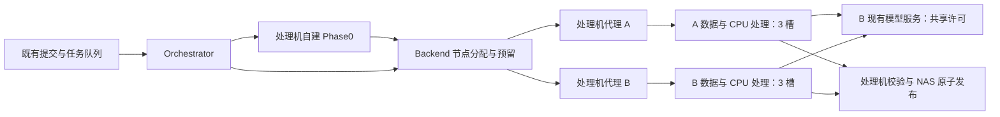

# A100 双节点纳管技术设计

> 2026-10-12 范围补充：本设计的A/B分配/上传/远端执行仅适用于自建与NVIDIA。主线场景v0.4在处理机执行，远端只收模型请求；共享模型许可仍按原同一池使用，不给场景创建A100执行/空间预留。详见 [主设计](/home/wang/work/doc/prd/rosbag-catalog-integration/DESIGN.md#73-v04-场景专用接收执行与界面补齐)。

契约：**MN-v1 / DESIGN_READY**，2026-10-12。本文冻结目标契约，均未实现。
需求见 [PRD](PRD.md)，任务状态见 [TODO](TODO.md)，事实和授权见 [HANDOFF](HANDOFF.md)。

## 1. 最小架构与边界

Backend 仍是唯一业务数据库写入边界。Orchestrator 通过 Backend 分配节点，再向对应代理派单。处理机运行两份现有 A100 代理，分别经 SSH 使用 A、B；每实例一个节点，不新增调度服务或节点数据库。

本期只有自建 A100 段、NVIDIA 段采用双节点。Phase0、场景切片队列、NAS 发布和模型许可仍使用各自现有资源边界。SSH/rsync/恢复记录不允许以“默认 A”覆盖已绑定 B 的 run。

## 2. 部署 profile 与目录

### 2.1 身份和配置

- 稳定 `node_id` 为 `A`、`B`；执行池 executor_id 分别为 `a100-A`、`a100-B`，资源键沿用 `A100_COMPUTE_IO`，capacity=3。
- profile 按 `(environment, node_id)` 查找，包含 enabled、profile_version、SSH 连接引用、代理 URL、数据/工作/测试/锁根、Python/ffmpeg 路径、路线能力和空间配置。入口为拟新增 `A100_NODE_PROFILES_FILE`，由部署文件管理。
- 自建预算、NVIDIA 预算、安全余量以正整数 bytes 配置，分别命名 `self_built_task_budget_bytes`、`nvidia_task_budget_bytes`、`safety_free_bytes`。预算不填或无效时仅禁止新准入，不关闭历史恢复、查询和清理能力。
- 不把密码、私钥内容、token 写入 profile、快照或文档。profile 记录凭据引用，处理机到 B 的专用 key 安装及 known_hosts 仍待 MN-09 验证；网络端口可达不等于 SSH key 授权可用。
- A 保留现有代理端口、恢复目录和锁根。B 使用独立端口、恢复目录和锁根，安装清单必须显式填写实际值并检查冲突，不在本轮假定已存在。Backend 容器访问代理沿用现有宿主机网络入口，不能把容器内 loopback 当宿主机地址。
- 同一节点 test/production 根不重叠；环境校验从全局固定 A 根改为准确匹配对应节点的批准 profile，不放宽为任意绝对路径。

### 2.2 生产目录映射

下表中 `B_BASE=/home/sysadmin/data/disk03/rosbag-catalog`。

| 用途 | A 已有位置 | B 目标位置 |
|---|---|---|
| 自建 origin | `/data/xl_origin_dataset` | `<B_BASE>/data/xl_origin_dataset` |
| 自建 staging | `/data/xl_origin_dataset_staging` | `<B_BASE>/data/xl_origin_dataset_staging` |
| 自建 infer / 原地 Phase3 | `/data/xl_infer_dataset` | `<B_BASE>/data/xl_infer_dataset` |
| 地图 | `/data/xl_maps/maps` | `<B_BASE>/data/xl_maps/maps` |
| NVIDIA origin | `/data/nvidia_origin_dataset` | `<B_BASE>/data/nvidia_origin_dataset` |
| NVIDIA infer | `/data/nvidia_infer_dataset` | `<B_BASE>/data/nvidia_infer_dataset` |
| NVIDIA runs | `/data/nvidia_pipeline_runs` | `<B_BASE>/data/nvidia_pipeline_runs` |
| 路线仓库 | `/home/xmyf/wzd/repos/{self-built,nvidia}` | `<B_BASE>/wzd/repos/{self-built,nvidia}` |
| 执行链接 | `/home/xmyf/wzd/code/{self-built,nvidia}` | `<B_BASE>/wzd/code/{self-built,nvidia}` |
| 自建 runs | `/home/xmyf/wzd/runs/<run_id>` | `<B_BASE>/wzd/runs/<run_id>` |
| 测试根 | `/home/xmyf/wzd/test/rosbag-catalog` | `<B_BASE>/wzd/test/rosbag-catalog` |

B 测试根下沿用 A 测试 profile 的相对结构，包含独立 data、repos/code、runs 等。A 的历史测试布局不因本期扩容重新整理。数据不以软链接伪造 `/data`；code 执行链接继续指向本节点、同环境的路线 Git checkout。不引入 NVIDIA phase3/staging 根。

本期配置要求各节点的大体积数据写根（origin/staging/infer）位于其同一数据文件系统；启动探测按远端文件系统身份去重。数据根跨盘、错挂载或挂载变化则 `NODE_FILESYSTEM_MISMATCH`，待明确 profile 后启用，不自动把多个盘的容量相加。沿用A的work/run/锁元数据根可以在另一文件系统，分别检查可用性和写权限，其空间不与数据盘相加；不可写时节点同样不准入。

## 3. 数据身份、字段和兼容

### 3.1 最小字段

| 实体 | 拟新增字段 | 语义 |
|---|---|---|
| PipelineRun | `execution_node_id` String(32) nullable | 未分配为 NULL；成功分配后永久保留。 |
| PipelineRun | `execution_profile_snapshot_json` Text，默认 `{}` | 冻结非秘密执行配置：节点、环境、profile 版本、根、执行路径、预算及文件系统身份；与业务脚本/数据 revision 快照分开。 |
| PipelineRun | `reserved_disk_bytes` BIGINT，默认 0 | 在途完整任务预算；释放后归零，原预算仍在执行快照及事件中。 |
| PipelineRun | `execution_reservation_state` String(16)，默认 `NONE` | NONE/HELD/UNKNOWN；HELD 和 UNKNOWN 均占一个槽及预算，不受短租约过期影响。 |
| PipelineRun | `execution_slot_id` String(16) nullable | `slot-0`～`slot-2`，由节点行锁下分配可用编号，不能用当前人数生成可能重复的编号。 |
| SourceCopy / Artifact | `storage_node_id` String(32) nullable | 仅 A100 远端文件取 A/B；NAS/local 保留 NULL 及原 storage_type。 |
| ResourcePool | `admission_revision` BIGINT，默认 0 | 节点持久占用的修改版本，解决探测后并发释放/新增导致容量样本失效。 |

PipelineRun 增加 `(execution_node_id, execution_reservation_state)` 索引，用于节点占用小表查询；按已有 source_id/source_generation 索引查源归属。字节数使用 BIGINT，不新增帧级节点列，不引入节点状态大 JSON、分区或新配额表。

### 3.2 源归属与幂等

同一 `source_id/source_generation` 的远端 run、copies、artifacts 必须归属同一个节点。分配在源围栏/BagRecord/run 锁下查已有归属，已有数据或执行快照优先；冲突为 `SOURCE_NODE_CONFLICT`，不得按目录名猜测或自动迁移。

节点只表示物理位置，不进入 source_id、数据 revision、业务提交幂等键或源代次。清理墓碑及重新导入资格保持原契约；节点选择不能绕过已清理源或 active fence。新代次仅在原显式重新导入协议证明上代数据已清理且没有未知写者后才允许重新选择。

新远端 SourceCopy 身份摘要加入 node_id，沿用现有 source/run/storage_type/path 维度；NAS/local 摘要保持原算法。A 的历史 identity_key 不重写：upsert 优先匹配已存在的旧 A 键且核对全部字段，再匹配节点化新键，避免重放创建两个副本。B 不采用旧 A 键回退。Artifact ID 和 DatasetFrame 幂等键保持原有规则。

新远端路径必须显式携带节点；回调由 Backend 核对 run 冻结节点、环境、根和 source_generation。帧文件通过 artifact/run 解析节点，若两者冲突则拒绝，不能仅从相同路径字符串决定位置。新记录漏节点不能采用历史兼容回退。

### 3.3 历史与迁移

先只读盘点 legacy run/copy/artifact 及恢复文件。能证明位于既有批准 A 根的历史远端记录标 A；NAS/local 保持原义。已有在途 A run 必须被纳入节点占用或先等待空闲切换，不能让新 3 槽与旧租约各计 3 个。

新字段以 additive migration 增加；历史解析与小表回填有界、幂等，不重写 DatasetFrame。只有明确无上传、下载、目录创建或未知启动记录的未启动任务可保持 NULL。证据不足的旧 run 标为待对账，不能因缺少 Artifact 推断未写入。

NVIDIA 未分配任务的旧 `relative_path`/业务配置根只是历史模板。MN-05 必须在分配后、首次写入前原子落下所选节点的规范 origin 路径及执行快照；原 source_identity、revision 和提交回执身份不变。任何相关源围栏按该源全部历史关联核对，不能只看替换后的新路径而遗漏旧墓碑。

## 4. 原子分配与最小接口

### 4.1 容量计算和短事务

有效余量 = 远端实时 free_bytes − 所有 HELD/UNKNOWN 完整预算之和 − safety_free_bytes。对候选节点要求 `有效余量 >= 本任务预算` 且占用槽数 < 3。扣完整预算即使部分字节已写入，因此可能保守排队。

1. Backend 读取 enabled profile 和节点池 admission_revision，在事务外调用各代理的有界远端探测；健康与容量不使用代理进程 HTTP 200 代替。
2. 进入短事务：依既有围栏契约锁源围栏 → BagRecord → run → 按 node_id 顺序锁候选 ResourcePool。再次核验任务租约、源代次、归属、profile 版本及清理状态。
3. 比对探测时读取的 admission_revision；不一致即样本作废，退出事务后重新探测。新增/释放/接管持久占用都递增对应 revision；不能在锁内执行 SSH、rsync 或长探测。
4. 已绑定源仅检查原节点；新源按有效余量降序、node_id 升序选择。校验 profile 和远端文件系统身份一致，探测样本距当前时间不超过 10 秒，否则重探。时钟使用现有 app.clock；代理探测时刻由 Backend 本地记录，避免远端时钟差影响准入。
5. 同事务写节点和快照、HELD、预算、唯一可用 slot、ResourceRequest/ResourceLease、revision 和分配事件，commit 后才允许首次远端写入。run 同 attempt 已持有占用时返回同一分配，不重复申请。

占用统计为 HELD/UNKNOWN run 与尚未接管的 legacy 活跃 A100 lease 的 run_id 并集，不双计数。切换后自建/NVIDIA的旧 `leases/acquire` 不能绕过分配入口单独生成另一个 A100 槽，未分配请求须进入节点准入或明确拒绝；在途legacy只允许已有凭据心跳和对账。`DELETE leases`可以结束短凭据，但不能单独释放持久占用；持久释放必须核验原节点全部写者结束的证据。预算与短租约职责分离，复用既有资源池，不增加磁盘配额服务。

### 4.2 接口契约（均拟新增/扩展）

| 接口 | 输入/输出与限制 |
|---|---|
| `POST /api/v1/pipeline-runs/{run_id}/allocate-node` | 内部调用：attempt、现有 task_lease_token、幂等键；客户端不提交 node_id、绝对根、预算或 SSH 地址。返回 decision、execution_node_id、execution_profile_snapshot、resource_lease_token、slot_id。 |
| `GET <节点代理>/health` | 保留 status/active_runs；增加 node_id、environment、profile_version、远端 reachable、roots_writable、文件系统 identity/free_bytes 和 blockers。Backend 只信配置中对应实例的探测。 |
| `POST <节点代理>/run` | 扩展既有派单：execution_node_id、冻结执行 profile、占用/任务凭据。实例检查自身节点及 Backend 的有效分配，不匹配拒绝且零业务写入。 |
| 既有 run/Artifact/SourceCopy 查询和回调 | 增加对应节点字段；请求方不能修改已冻结归属。NAS/local 字段为空不表示 A100 节点 A。 |

分配成功 `decision=ALLOCATED`；暂时无候选返回 `decision=WAITING` 及 `NO_SLOT`、`INSUFFICIENT_SPACE`、`BUDGET_UNCONFIGURED`、`NODE_UNAVAILABLE` 等 reason。UNKNOWN或短凭据已过期且尚未对账的占用返回WAITING/`REMOTE_STATE_UNKNOWN`，只触发原节点恢复，不重新派发。WAITING 不冻结为成功幂等回执，后续可用同一业务身份重试；成功回执只在占用及凭据仍有效时重放，旧 attempt/已释放凭据不能复用。

身份冲突、源代次/围栏不允许、客户端凭据失效为明确 409/403；参数错误为 422。未知归属暂停该源并显示 blocker，不标记业务处理成功。Orchestrator 遇 WAITING 使用队列释放入口交还尚未派发任务，扩展现有仅 Phase0 可用的释放能力；同轮继续检查另一节点/队列，不在单线程内无限等待。

## 5. 启动、占用与失败恢复

- commit 的节点绑定是最早的冻结点。分配之前可在 A/B 间选择；绑定之后即使尚未收到代理确认，也不重新选节点，采用原节点对账后重试。这满足仅启动前选择，并避免额外的解绑/迁移协议。
- 分配失败未 commit 不占用；已 commit 但 HTTP 超时不证明未启动，保留 HELD/UNKNOWN 和原节点。代理/Backend 使用 run_id、attempt、PID/start ticks、写者锁及持久恢复文件对账。
- `HELD → UNKNOWN`：代理失联、短租约过期且写者状态未知；保持槽和预算。`HELD/UNKNOWN → NONE`：真实证明任务与全部写者停止、上传/下载子进程退出后，原子释放资源、预算及 slot，递增 revision；execution_node_id/执行快照仍保留。
- 已知 NOT_STARTED 可释放占用以避免漏槽，但节点仍绑定；下一次原节点重获槽与预算后再启动。重试 attempt 递增不产生第二份并行占用。
- 任务状态 DONE/FAILED、proxy active_runs 为空或 launcher 主 PID 退出，都不能单独证明孤儿写者退出。失联时不因租约 TTL 给第 4 个任务腾槽。
- 既有在途任务缺少新预算配置时允许心跳、对账及终止收敛，不重新做新准入。已结束任务的新重试需要预算齐全；不凭“恢复”绕过新写入准入。
- profile 修改不会更换已绑定 run 的根或 SSH 身份。节点不可达时原节点恢复等待；配置或根变更与快照矛盾时阻断，保持原快照进行人工核对。

## 6. 两路线、读取与 NAS 发布

MN-05 将绑定 profile 传入自建/NVIDIA 配置对象和依赖回调。上传、launch、状态读取、manifest、描述文件/帧导入、rsync 来源都必须来自同一节点；恢复路径不得回落到全局 A 参数。

自建 Phase0 的处理机副本只有在所选节点上传后 manifest 校验、Artifact 登记完成才按既有规则清理。NVIDIA origin 路径由所选节点根生成，approved 业务配置中的数据/脚本 revision 和处理参数继续冻结，执行位置独立保存。

NAS 发布仍在处理机回传、校验和同文件系统原子发布，B 不要求额外挂载 NAS。保留既有 publish_origin_to_nas/publish_final_to_nas 语义，不因节点 B 擅自开启发布。

模型脚本继续使用 `127.0.0.1:8002`：A 已有转发到 B，B 使用本机服务。VLM_PERMITS 和 NAS_PUBLISH 继续使用现有共享池身份与容量，不能把 node_id 拼进模型池 executor_id。Phase1/Phase3 内部进程和请求并行参数沿用现有批准配置，MN-09 核验总模型压力；本期不修改 Phase0 算法或扩展 GPU 准入。

## 7. 查询、访问和清理

run 详情和数据远端位置展示 A/B；访问描述返回正确节点的连接信息引用及路径，NAS 链接保持 NAS。文件路径相同但节点不同是两个物理目标；跨源引用保护必须同时比较节点和路径。历史 frame 路径经所属 run/artifact 解析，不逐帧重写。

清理仍复用源围栏、预览/确认、签名、writer 锁和双完成协议。节点化计划冻结 node_id、environment、profile 版本/摘要、批准根、source_generation、targets；这些内容进入 digest/确认签名和执行器身份校验。物理冲突域为 `(environment, node_id, canonical_path)`，源业务围栏仍跨所有关联 run 检查，防止换节点绕过源墓碑。

A 的旧计划不原地补字段。旧无节点计划只按明确旧协议执行 A 的既有冻结范围；新节点化能力版本冻结为自建 `bag-cleanup-plan-node-v1`、NVIDIA `nvidia-cleanup-plan-node-v1`、检查 `bag-cleanup-inspection-node-v1`，旧 worker/executor 不得领取。多节点矛盾先阻断，不新造跨节点批量删除。UNKNOWN 不当作 ABSENT；重试使用原节点和原确认范围，不跨节点重算或扩大计划。NAS 内容、地图、共享模型和共享缓存仍按原清理契约保留。

NVIDIA 删除专项的衔接见 [补充契约](/home/wang/work/doc/prd/rosbag-catalog-nvidia-cleanup/DESIGN.md#10-a100-双节点衔接契约mn-v1)；MN-06 只适配实际已接受的删除能力，不把未实施 NC-01～09 当作现有功能重新实现。NC能力未接受时，NVIDIA清理入口保持明确不可用并说明原因，纯节点契约验证仍可完成；NC接受后才能实际启用其节点化删除，不影响本期NVIDIA处理接入。

## 8. 验证、校准、启用与回滚

开发先用本地双节点代理替身和隔离 MySQL 验证；TESTER 对固定集成 SHA 取证，详见 [ACCEPTANCE](ACCEPTANCE.md)。预算缺失的生产节点可保持 enabled=false，本地测试使用明确的 fixture bytes，不将其写成生产默认值。

MN-09 的安装/校准清单：处理机到 B 专用 SSH key 与 known_hosts、两路线 Git revision、Python/ffmpeg、地图、权限、writer/cleanup helper 版本、容量与文件系统身份、测试根隔离、模型连通性。以代表性输入记录下载、解压、staging、infer 和残留的峰值新增空间；运维据证据填写预算和安全余量，范围超出样本时先重校准。

MN-10 生产前确认 MySQL 自动备份及可校验备份、迁移与回滚、旧在途 A 占用接管、已确认旧清理计划版本、配置与端口冲突。发布须用户明确授权并执行项目规定的 `--apply --production`，随后更新本地隔离栈至相同或更新版本并验证。

回滚先禁止新准入，保留 A/B 的在途恢复入口及数据。存在 B 绑定 run/产物时，禁止降级到只能访问 A 的旧应用或删除新增节点字段；可关闭 B 新接单并继续运行节点化版本。只有隔离库和空闲、无 B 依赖证据满足时才演练 schema downgrade，不通过删 B 记录“回滚”。生产数据和 NAS 输入不变。
