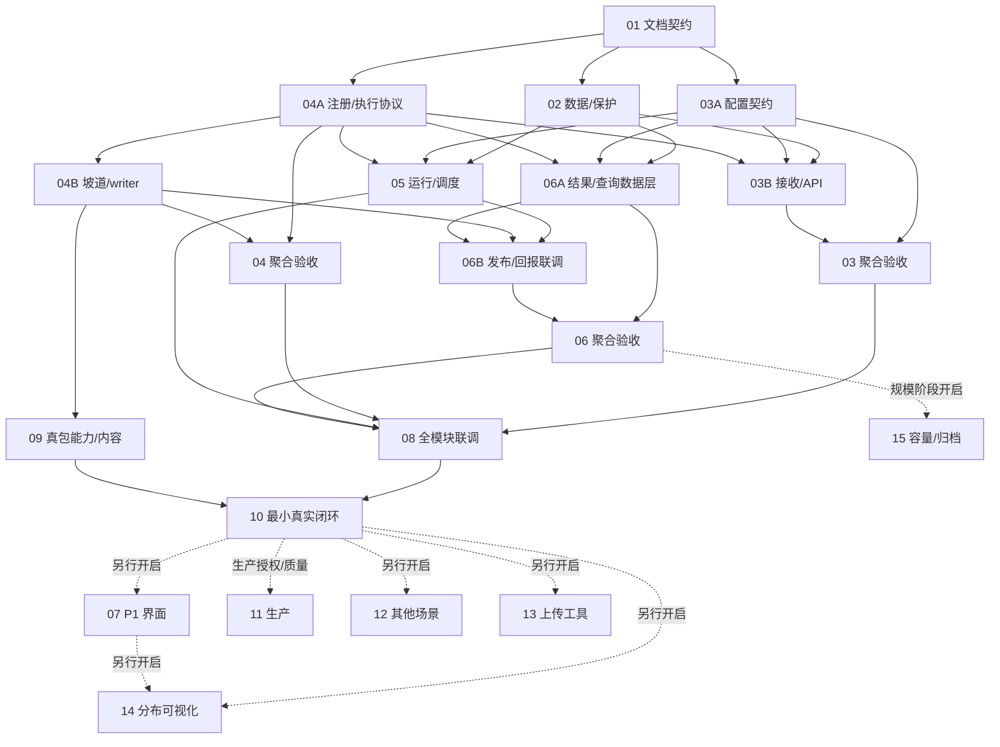

当前派单详情与互斥文件范围见 [inbox/control/V04-UI-RESUME-20261014.md](inbox/control/V04-UI-RESUME-20261014.md)；旧父16C由A/B/C三个叶承接，不再整单派B。16A/16B/12S-A/B/C/11S首包已接受事实不重置。

> **当前执行决定（2026-10-14T11:25:19+08:00）：用户恢复 v0.4 最小界面闭环，并要求原 OCR 未修项进入任务。** 唯一入口 [V04-UI-RESUME-20261014](inbox/control/V04-UI-RESUME-20261014.md)；TASK-16C-A/B/C 三路开发、16D准备/固定快照验收、16R审查遗留并行。下面2026-10-13 UI暂停及旧“不恢复UI”仅为历史。水雾上线接受保留；大包优化仍等ros2_slice交付，其他DEFERRED不恢复。状态唯一见TODO §8。

<!-- POST-SPRAY-CLOSEOUT-20261014 -->
## 旧执行入口：上线后原任务收尾（10:49历史，现并行UI恢复）

用户要求原五角色继续既定收尾，入口 `inbox/control/POST-SPRAY-CLOSEOUT-20261014.md`。TASK-16B/12S-A/B/C/11S受控首包的接受结论不重置；TASK-11S-BATCH-1012仍RUNNING，三份绑定已恢复（不再待绑定），剩独立复用验收、大包终态/跨DB3、空包拒绝及资料缺口；TASK-12S-D仍PARTIAL。本条为旧收尾历史；2026-10-14用户已明确恢复UI16C/16D，其他DEFERRED不恢复，平台大包优化等ros2_slice交付。协调者据最新回执同步原任务行，不建立第二业务状态表。

> **历史协作恢复决定（2026-10-13T20:58:48+08:00，UI优先级已覆盖）**：用户明确恢复飞书原协调者及A/B/C/TESTER和按需审核。临时Codex接替结束；本批唯一任务TASK-11S-BATCH-1012，先读inbox/coordinator/SPRAY-BATCH-1012-20261013/HANDOFF.md。旧“协调poll暂停/等待16B/S9b”等为历史，不再执行；UI仍暂停。

> 当前水雾收尾事实（2026-10-13T20:35:24+08:00）：main/生产/本地3c9c496，受控test首包原run attempt2 SCENE_DONE、八步DONE、入库获取/两次对账/原包SHA全部PASS，TASK-11S受控首包DONE。19:00目标未达；12S-D广义矩阵仍PARTIAL，UI继续暂停。详见 reviews/TASK-11S/production-first-bag-20261013.md。

<!-- five-role-v2 -->
> **当前协作规则 v2（2026-10-10T14:19:08+08:00）**：先读 [角色启动](SESSION-START.md)、[统一协议](inbox/PROTOCOL.md)、[绑定](ROLE-BINDINGS.json)。协调者只调度、核对证据、串行OCR和批准合入；独立验证由TESTER执行。群聊与定时协调者同权限，单写租约互斥。5分钟真正巡检、20分钟固定多行短报、关键事件立即通报。下文旧10分钟monitor/机械化身/协调者自跑测试/一行格式/先合后审只属于历史，不再作为操作规则。业务状态、编号、分支、ACK和证据未改。

# Bag 场景处理服务任务单

> **历史优先级 v0.5（2026-10-13，已由顶部UI恢复覆盖）**：先做水雾接收→识别→切片→发布入库→已有API获取；界面增量暂停。当前范围/新增叶任务唯一见 [§9](#9-v05-水雾优先与生产接入2026-10-13)。§8保留16A DONE/16B门禁和16C已有交付证据，但原“三项含页面全接受才验收”不适用于水雾发布；16C/旧16D/父16暂停等待恢复，16A/16B仍是后端基础。TASK-12只提前水雾子集，其他场景保持DEFERRED。今天生产目标须满足发布门禁，未据此标记生产已通过或启动部署。

> **v0.4 / DESIGN_READY（仅文档）**：新增任务状态表和完整卡片在 §8；§1及原派单保留TASK-01～15运行历史，§3/6/7是旧P0拆分背景。TASK-10 DONE不代替本轮目录/正式代理/页面验收。07B在途交付先按原检查点衔接，07C预览不作为本轮前置。协调者冻结base和文件owner后派TASK-16子任务，本次规划不自行启动业务开发。

版本：v0.4，2026-10-12；TASK-01～15状态/记录及既有授权保留。新增场景隔离、处理机执行与基础界面归TASK-16，状态在§8。协调者（飞书「后端功能开发」）负责验收/派发/共享文档；聚合父不重复派出完整实现。

## 1. 唯一任务状态与依赖表

TODO 是专项任务状态唯一入口。协调者更新状态/owner；执行者只能维护自己的回执，不能并发改本表。当前 P0 本地实现已有用户授权；READY 仍需协调者核对依赖、输入和文件/资源后派单，生产门禁不因此解除。

**状态标志**：✅=DONE（已合入 main + 协调者验收闭环）｜🔁=REWORK（OCR 返修中，owner 执行）｜🔧=RUNNING（owner 开发中）｜⏸️=READY 待派（依赖齐备，等空槽）｜⏳=WAITING（被依赖阻塞）｜🚫=BLOCKED（缺外部授权）｜🕓=DEFERRED（阶段未开启）｜📄=文档项

| 任务 | 标志 | 交付行为 | REQ / AC | 依赖 | 阶段与状态 | owner / attempt |
|---|---|---|---|---|---|---|
| TASK-01 | 📄✅ | 最小范围、接口、完整并行/接续及共享文档契约 | REQ-01～13 / AC-01～13 | 无 | DONE（仅 v0.3.2 文档） | 协调者 / 文档 |
| TASK-02 | ✅ | 必要数据模型/迁移、血缘标签、索引与清理防线、旧 ID 风险盘点 | REQ-02、04、08、13 / AC-02、04、08、13 | TASK-01 | DONE（527b033+e10cab4+a317e48 合入 main a317e48；协调者独立复验 MySQL 8.4 隔离库 upgrade/downgrade/派生回滚拒绝/重入 + server_default/CASCADE DDL 硬证据全过） | 1号会话 / attempt-1 |
| TASK-03 | ✅ | 完整接收服务聚合验收 | REQ-01、08、10、13 / AC-01、08、10、13 | TASK-03A、TASK-03B | 【16:15 协调者巡检】03 聚合 MySQL 路径仍未验收，03B R2 返修 f088c2b **未合入**（OCR 在途，与 06B c67600d 同批合入，R2-05 契约互锁）；【2026-10-11 15:17 收口】强复审 R2I-20261010-06 **PASS**（target `62a85bf`，CORRECTION 0 / VERIFICATION_GAP 1（I-1 LOW 不阻断，1号 i1-1 在途）/ OUT_OF_SCOPE 0，V-1/V-2/V-3 全裁决）→ **03 聚合 DONE**，冲突解除。WAITING（强模型 7 条修复全进 main；#1 gate=误报解除；outbox 联调 **PASS 6/6**（23:10）；**OCR 补审全闭环**：B5a f11e617 0 findings、B5b 86baad5 核心零发现（3 documentation 条已修复合入 3b78736）、B6 6ce7b7a complete+2 条闭环（backfill high 合入 b5efba2）、B3 d1f2eba 5 条对照当前 HEAD 仅剩 2 low 已修（b75c6bf）、B7 db4bec7 **0 findings**（08:51）；03B 返修 6f1a9ad 合入 3b78736）→ **03 聚合重验 DONE（08:51，main 3b78736）**：迁移 head 单头 20261009_02 ✓、outbox purpose-schedule-event/v1 字段集齐（profile_version/effective_config_hash/bound_source_generation/capability_version+capability_config_hash 冻结）✓、main 全量 **783 passed / 0 failed**（SQLite 口径）。**R2 第二轮（2026-10-10 11:31 结果到达、11:40 裁决）退回**：R2-02 outbox 投影 MySQL 方言 bug（双引号=字符串常量，SQLite 全绿系统性遮坑）+ R2-01 已有库增量迁移 1101 → 03 聚合（03B）MySQL 路径未验收，05 聚合 outbox 消费链 MySQL 未验收。【12:35 化身】1号 attempt-5-rework f088c2b（R2-01/02/05-create）机械核验全绿（8/84/812+3devflow/ruff 绿、merge-tree 0 冲突）但未合入挂 NEEDS_MAIN_REVIEW。**13:52 主会话裁决放行**：①selection_json 第 4 列去 DEFAULT=处置正确（写入侧 :322/:232-234 显式赋值+读取 `or` 兜底）②已应用库无需 de-DEFAULT 迁移=推断成立（MySQL 本不允许 TEXT 字面量 DEFAULT，无存量库可停在带 DEFAULT 状态）③R2-05 契约两端已齐（2号 c67600d switch 侧 :433 分配 id 序号已核实）→ 合入前串行 OCR 在途（化身接力），无 high/critical 后与 06B 一并 --no-ff 合入 + TESTER R2-05 交错 MySQL 联调。【16:35 巡检】f088c2b OCR 已收口（1 medium+1 low）→ 回派 1号 attempt-5-rework-2；1号 16:27 ACK 已开工（wt-01 已改 scene_schedule_consumer.py + test_scene_r2_rework_1.py 共 +134/-26，未 commit），【16:49 巡检】1号 attempt-5-rework-2 **c285e2e 交付**（16:41，REVIEW_PENDING，2 文件 +145/-24 零越界，机械核实全绿，自测定向 44/全量 813+ruff 绿）→ 协调者 **B9 增量 OCR 在途**（16:48:18 起跑，session `cdba7e7f`，硬截止 17:15）；B9 无 high/critical 即与 c67600d+a07c181+9325155+86b2cc1 **【17:20 巡检收口注记】B9-r3（c285e2e）17:11:29 Review complete 0 findings**；17:12/17:13 群聊主会话回合已完成 `e5d356f`（03B：f088c2b+c285e2e）+`74ba3bf`（06B：c67600d+a07c181+9****55+86b2cc1）两笔 --no-ff 合入 main（**均 OCR 门禁解除后**，reflog/parent 链核实），已推 origin，迁移 head 单头 20261009_02 ✓；**TESTER 终测派单已发**（inbox/TESTER/TASK-06/r2-final-mysql-e2e.md，17:15，7 场景 MySQL 8.x 隔离库）→ **【18:24 终测定性】**TESTER r2-final-mysql-e2e 交付：**6 PASS / 1 FAIL**——S1 R2-01 FAIL（`alembic_version` VARCHAR(32) 容不下 33 字符 head revision `20261009_02_ingest_frozen_columns`，MySQL upgrade head 必 1406；R2-01 原目标去 TEXT server_default 本身成立，败在链尾越宽）→ **回派 1号 `attempt-5-r2-final-s1-fix` 最小修复**；S2 outbox 方言+_mark rowcount / S3 switch 并发 / S4 R2-05 契约 / B8c 路径逃逸 / B8a 死锁回归 / r6 回归 **全 PASS**（18:11 的 S3 新 FAIL 信号被最终报告推翻，无 1093）；缺陷2（中低）=06B 测试夹具 `_parent` tag>10 生成 27 字符 uid 越 VARCHAR(26) → 回派 2号 `attempt-1-r2-final-fixture-fix`。**06 聚合放行业务门禁不通过**，03 聚合维持 WAITING 待 S1 复测 PASS + 强模型增量复审。**【20:13 巡检注记】TESTER attempt-2 交付：S1 三 AC 全 PASS（1406 高阻塞解除，MySQL 迁移链验收缺口收口）→ 03 聚合（03B）MySQL 路径**验收 PASS**，03 随 06 聚合一并转 DONE（剩强模型增量复审）（21:53 注：TESTER attempt-3 PASS，03 仍随 06 聚合等强复审，口径不变）；唯一残留 FAIL=缺陷3（06B app 面，见 06B 行） | 协调者 |
| TASK-03A | ✅ | 配置 DTO、纯解析、能力读取协议及限额 | REQ-01、10、13 / AC-01、10、13 | TASK-01 | DONE（67f9f4c 合入 8e97ef1，OCR 三轮收敛，接口 scene-config-v1） | 3号会话 / attempt-2 |
**代码全收口 main 533aa1c（22:37，推 origin）**：F2 并发 f11e617（9506457）+ #3/#4生产端/#6 返修 86baad5（7 文件 +943：用途控 PHASE0+双过滤、接受时冻结 hash 绝不发 NULL-hash 事件、PATCH/bind 共享 FOR UPDATE；迁移 20261009_02 接 20261009_01 无多头；定向 17+全量 777 独立核实）；#1 critical 裁决=误报（20:54 测试者 MySQL 8.4 general_log DDL 铁证）。**05↔03B 真实 outbox 联调 PASS 6/6（测试者 23:10 交付 verify-05-03b-outbox-e2e.md：真实 bind emit→消费建 run+身份键非空、冻结 hash 逐字节一致+registry 漂移重放 reused=1/created=0、漂移建 SCENE_UNAVAILABLE 失败 run 三重留痕、缺 hash→DROPPED+error_reason 不重捞、50 坏事件两轮清空不堵队、self_built 不建 run）**。剩：03B 增量 OCR 补审（B5a f11e617 **0 findings** 23:53 收口；B5b 86baad5 23:54 起跑；B6 resume 05 核心 3 文件排队）+ 1号 backfill 去重返修（REVIEW_PENDING 待核） | 3号会话 / attempt-4 |
| TASK-04 | ✅ | 完整坡道适配聚合验收 | REQ-03、09、10 / AC-03、09、10 | TASK-04A、TASK-04B | DONE（**重验 2026-10-09 20:39**：04B #2 CDR 对齐 hotfix 34c380d 合入 640c5a8 后，协调者复跑 verify_task04_agg.py 端到端 **PASS**——slope-v1 enabled+适配器注册+config_hash 一致+跨字段约束拒绝+真实 Image 封装 analyze→SUCCESS/6 段，对齐改造零回归） | 协调者 |
| TASK-04A | ✅ | 注册/区间/执行协议、测试能力及正式坡道描述 | REQ-03、10 / AC-03、10 | TASK-01 | DONE（a23c541 合入 94cfc2f，OCR 三轮收敛，接口 scene-capability/v1） | 2号会话 / attempt-2 |
| TASK-04B | ✅ | 坡道结构化适配、时间映射、writer 和证据引用 | REQ-03、09、13 / AC-03、09、13 | TASK-04A | **DONE（强模型 #2 CDR 对齐收口 2026-10-09 20:27）**：eaf632a 初版 + hotfix 34c380d 合入 main **640c5a8**（协调者独立核：_align4 按 CDR body origin 基准、解码端全部 32-bit 读点+编码端对称 base 语义、9 个 1/2/3 字节 padding golden、定向 35 passed、ruff 绿）；**OCR B4-r1 0 findings（21:35 收口，session 4b309814）**；04 聚合重验 PASS（20:39 端到端 analyze→SUCCESS/6 段） | 2号会话 / attempt-3 |
| TASK-05 | ✅ | 用途事件消费、场景运行 API、队列/执行面/租约 | REQ-01、03、06、08、10 / AC-01、03、06、08、10 | TASK-02、TASK-03A、TASK-04A | **强模型 3 条（#5/#7/#4消费端）修复收口 main c764f1b（20:42）+ 05↔03B 真实 outbox 联调 PASS 6/6（测试者 23:10）**：#4 冻结 hash 生产端→消费端真实事件流端到端验证通过（见 03B 行联调明细）。**OCR 全闭环（2026-10-10 01:17）**：①B6 high（backfill 未按身份去重）已修复合入 main **b5efba2**（00:55）②B6 resume 回放确认 6ce7b7a = **Review complete**（2 条已闭环），修正上轮偏严的 incomplete 判定 ③B3（d1f2eba 05 主体）收口 5 条逐条对照当前 HEAD：**medium #4 + low #1 已过时**（6ce7b7a 已修/已移除）、#3 reviewer 自撤回、**仅剩 2 条 orchestrator 观测 low（errors 未 log + 空轮次刷屏）并入 1号小单**（低优先非功能 bug）④1号 E402 风格小单（00:56 派）。**05 功能正确性已由 6ce7b7a 修复 + outbox 联调 PASS 6/6 保证**。1号文档级小单已交付并验收合入 main **3b78736**（08:36：641aacd E402 import 置顶 + b75c6bf orchestrator 观测 2 low 修复+2 回归测试，ruff All checks passed、780 全量）。**【17:20 巡检收口注记】db4bec7 OCR 早已收口（08:51，0 findings）**，05 第一轮修复+OCR 全闭环；**outbox 消费链 MySQL 路径随 03B f088c2b/c285e2e 已合入 main 74ba3bf**（17:12），终测并入 TESTER r2-final-mysql-e2e 场景 2（R2-02 outbox 方言+_mark rowcount 接线）→ **【18:24】S2 已 PASS**（真实列值非字面量 + poll→CONSUMED 终态 + rowcount 0 行计 errors 不静默）；05 随 03 聚合一并转 DONE，剩余门禁=S1 迁移修复（1号 `ceeac16` 已合入 main **0f6aa87**，19:0x，OCR S1-r1 0 findings）+ TESTER S1 聚焦复测 PASS（19:07 已派）+ 强模型增量复审 | 1号会话 / attempt-2 |
【2026-10-11 15:17 收口】强复审 R2I-20261010-06 PASS → **05 聚合 DONE**（I-1 VERIFICATION_GAP 为既有夹具缺口、非本增量引入，1号 i1-1 最小修复合入前不阻塞 DONE 与 TASK-08）。【15:45 收口】1号 i1-1 `6823f2d`（夹具 bag_uid hex16→hex9 + len≤26 assert，零 app 变更，真 MySQL 8.4.11 文件级 36 passed RC=0 容器 0 残留）独立核验全绿 → **--no-ff 合入 main `f9bafb0`**（推 origin，sanity ruff/SQLite 36/alembic 单头全绿）→ **I-1 VERIFICATION_GAP 关闭**；回归确认由 2号 TASK-08 attempt-1 联调项动态核对（base 按 ACK 口径以合入 commit `f9bafb0` 为准 rebase 复核），不另派 TESTER。
| TASK-06 | ✅ | 完整结果使用/发布恢复聚合验收 | REQ-02、04、05、06、07、13 / AC-02、04、05、06、07、13 | TASK-06A、TASK-06B | **【18:24】TESTER 终测 6 PASS / 1 FAIL，06 聚合放行业务门禁不通过**：两笔返修**均已合入 main**——S1 R2-01 迁移链 1406（1号 `ceeac16` revision 33→25 字符，合入 **0f6aa87**，19:0x，OCR S1-r1 0 findings）+ 06B 夹具 uid（2号 `6ee858b`，合入 c2dbe91，18:59，纯测试无 app 代码面）→ 剩 **TESTER S1 聚焦复测 PASS（19:07 已派，base 0f6aa87）** + 强模型增量复审（用户手动触发）→ 06 聚合解锁。**【20:13 巡检注记】TESTER attempt-2 已交付**（20:04）：S1 三 AC 全 PASS（迁移 1406 高阻塞**解除**）+ 不变式套件 39/40；残留 1 FAIL 经 TESTER 探针**纠正 attempt-1 误诊**=缺陷3（06B app 面）：reconcile 幂等二次 MySQL StaleDataError（`scene_result_report_service.py:928` commit，`UPDATE id=2` 匹配 0 行而新连接证实行存在且可更新；child uid 实测 22 字符非截断，SQLite 全绿遮坑）→ **已回派 2号 `attempt-1-defect3-reconcile-replay`**（base 0f6aa87，方向=幂等重放不得依赖 UPDATE 行计数语义，最小单 commit）；06 聚合放行业务门禁**仍不通过**（缺陷3 收口+TESTER 新 attempt 复测 PASS 前）。**【21:18 巡检】**2号缺陷3 `4e2158e` 已交付（21:14，单文件 +27/-3，真 MySQL A/B 复现闭环），机械核验全绿，串行 OCR D3-r1 在途（session 5ee653d5，硬截止 21:55）→ 收口后合入 main（推 origin）+ TESTER 新 attempt 复测 + 强模型增量复审（用户手动）→ 06 聚合解锁。【21:45 巡检】D3-r1 21:26 核实=化身回合结束被杀（4 组完成、无 run manifest、`--resume` 工具拒绝）→ D3-r2 重跑 **0 findings**（session `81a9e337`，365s，coverage 1/1）→ **`4e2158e` 已合入 main `5f0124b`（21:37 --no-ff，推 origin）**，合入后 sanity（alembic heads 单头/ruff 绿/SQLite 31 passed）；**TESTER 缺陷3 复测已派**（`inbox/TESTER/TASK-06/r2-final-mysql-e2e-defect3-retest.md`，base 5f0124b：reconcile 幂等二次真 MySQL PASS+定向不回归，不重跑已 PASS 场景）→ 复测 PASS+强模型增量复审（用户手动）→ 06 聚合解锁。**【21:53 巡检】**TESTER 缺陷3 复测 attempt-3 **已交付 PASS（21:47）**（reports/TASK-06/r2-final-mysql-e2e-attempt-3.md：reconcile 幂等二次真 MySQL 8.4.11 探针 2 次均 200 无 StaleDataError + 31 用例 RC=0 + 40/40 等价口径）→ 06 聚合放行业务门禁**仅剩强模型增量复审**：审查包 **R2I-20261010-06 已备（READY_FOR_USER_TRIGGER，base eff0479→target 5f0124b，含 R2-01/02/03 MySQL 结果+缺陷3+V-1~V-3 聚焦疑点）**，等**用户手动触发**→ 03/05/06 聚合 DONE → TASK-08。**【09:10 巡检注记 2026-10-11】codex 第三轮全链合审 REWORK（1 medium 阻塞 R-01 秒末截断 + R-02/R-03 两 low）回派 2号 rework-6 已 ACK 并实测开工（09:07，wt-04a-r6 base 6d30a68 已有代码改动）→ 06B/06 聚合门禁 = rework-6 交付 + 协调者验收 + 串行 OCR 增量 + TESTER 复测 + 强复审 R2I-20261010-06（用户手动，pack 随 rework-6 合入后更新 target）。
【2026-10-11 15:17 强复审收口】强复审 R2I-20261010-06 **PASS**（15:15 result 落盘，target `62a85bf`，patch sha256 `76ff031d…` 实测一致；V-1 独立真 MySQL 复跑 PASS / V-2 边界成立不构成 AC-07 违反、row_version 为普通列 pack 口径已纠正 / V-3 S1 三路径并档关闭）→ **06 聚合 DONE**；03/05 聚合同批 DONE → TASK-08 已派 2号。
【22:45 巡检收口注记】2号 rework-5 `5c854ea` 交付（22:38，codex 裁决 M-1/M-2/M-3 3 项，3 文件 +72/-5 零越界，自测含真 MySQL 8.4.11 A/B 无 CLIENT_FOUND_ROWS：旧微秒分支 rowcount=0/修复分支 no-op 零 UPDATE，SQLite 定向 32+全量 822+ruff 绿）→ OCR R5-r1 **0 findings**（session `94bdf176`，coverage 2/2，2m9s）→ 22:46 --no-ff 合入 main **`6d30a68`** 推 origin，sanity 全绿（alembic 单头/ruff/SQLite 32 passed）→ **TESTER attempt-4 复测已派**（`inbox/TESTER/TASK-06/r2-final-mysql-e2e-attempt-4.md`，base 6d30a68：M-1 微秒回归真 MySQL 生产默认连接语义+attempt-3 口径抽查+越界核对）+ 强复审包 R2I-20261010-06 **target 已更新 6d30a68**（pack_update_20261010_2245，等**用户手动触发**）→ 06 聚合放行=attempt-4 PASS+强复审 → 03/05/06 聚合 DONE → TASK-08 | **【14:08 巡检收口 2026-10-11】rework-9 `c2cee73`（codex 第七轮最终态 r10 B-02 最后一条意见）验收合入 main `62a85bf`（14:08 推 origin，sanity 全绿）→ codex 审查链七轮全部收口，不再起第八轮；TESTER attempt-5 PASS 4/4 已 ACCEPT（10:07）→ 06 聚合放行唯一剩余门禁=强复审 R2I-20261010-06（用户手动，target `62a85bf`，pack_update_20261011_1415 增量 patch eff0479..62a85bf 11 文件 +2032/-251 sha256 `76ff031d…`，材料=codex 七份报告+两轮 TESTER MySQL 证据+FOUND_ROWS 定论+测试 diff）→ 03/05/06 聚合 DONE → TASK-08 | 协调者 |
| TASK-06A | ✅ | 区间/结果仓储、验证协议、Bag 检索/血缘数据层 | REQ-02、04、05、06、13 / AC-02、04、05、06、13 | TASK-02、TASK-03A、TASK-04A | DONE（attempt-2 e92ef17 --no-ff 合入 main **8bd5618** 已推 origin+github：协调者独立核 3 文件纯新增 1585 零越界+merge-tree 0 冲突、定向 25 passed、全量 697 passed（3 failed=devflow 沙箱环境性）、ruff 全绿、5 返修逐条对照源码核实在位、OCR 代跑 c4ce66c..e92ef17 **0 findings**（session 20cd817a）；契约：段数等值门禁/switch_current 409 有界/零 DDL，见 attempt-2-decision.md） | 2号会话 / attempt-2 |
| TASK-06B | ✅ | 正式回报 API、原子发布、幂等登记、换版/对账（R2 首审 REWORK） | REQ-02、05、06、07、08 / AC-02、05、06、07、08 | TASK-05、TASK-04B、TASK-06A | **【16:35 巡检】06B 侧 OCR 全闭环不变；合入唯一剩余门禁=1号 attempt-5-rework-2 medium/low 小修 commit（wt-01 在途，16:27 ACK 已开工、未交付）+ 其增量 OCR 无 high/critical → 五笔+小修同批 --no-ff 合入 main（现 eff0479）→ TESTER 派单（R2-05 交错 MySQL 联调+R2-01/02/03 终测+路径逃逸断言）。【16:15 巡检（历史）】2号 r3 low 小修 **86b2cc1** 已交付（16:14:50，1 文件 -2 死代码，零越界核实，receipts/TASK-06B/attempt-1-r2-rework-3.md）；f088c2b OCR 在途（session 88c0f2c2 活跃，硬截止 16:30）→ 收口后接 `-c 86b2cc1` 增量 OCR → 无 high/critical 即门禁齐：**f088c2b+c67600d+a07c181+9325155+86b2cc1 五笔同批 --no-ff 合入 main（现 eff0479）**→ TESTER 派单（R2-05 交错 MySQL 联调+R2-01/02/03 终测+路径逃逸断言）。下方 13:52 起叙述为历史。 **已合入 main 2e674b2（09:07）→ 化身 11:26 补核收口（范围 7 文件 +1966/-1 零越界、wt-01 旧初版 2dc80c7 确认完全吸收、定向独立复跑 49 passed、origin 已推 eff0479；decision 补写 inbox/coordinator/TASK-06B/attempt-1-decision.md）**；返修 3 条逐条核实在位（reanalysis_id 透传+两用例独立 reanalysis_id+未改 05 代码）。**B8a OCR（6e6bb73 --exclude tests，app 全 6 文件）11:48 收口 = 6 findings（1 high 多场景 run 死锁 + 4 medium + 1 low，session 819c9dab，b8a-exit=0）→ 12:14 化身持锁记账 reviews/TASK-06B/attempt-1-rework/ocr-batches.md 并写 inbox/coordinator/TASK-06B/NEEDS_MAIN_REVIEW.md 挂主会话：fresh 模块首审出 high，定性/回派超机械范围，06B 不得收口、B8b（tests）是否补跑待主会话裁决**。**13:05 2号 R2 返修 c67600d 交付（REVIEW_PENDING，5 文件 +741/-182，R2-03~11 + B8a 死锁修复）→ 13:26 化身机械核验全绿（核心 50 passed、干净全量 805 passed+3 devflow 环境性、ruff 绿、R2 repro 8/8 反转、MySQL 8.4.11 五场景独立复跑全 PASS、merge-tree 0 冲突、零越界，证据 inbox/coordinator/TASK-06B/attempt-1-r2-rework-verification.md）→ 13:35 B8c OCR r1 收口出 1 [security · high]（publish:156-157 `_SAFE_VEHICLE_KEY_RE` 含 `.`，`..`/`.` 漏网，与 B8a medium#3 同域）+ 2/3 文件超时（r2 13:36 起补审 report_service 在途）→ fresh 红线触发挂起。**14:01 主会话裁决**：B8c high 确认真缺口（OCR 常量名编的但后果实测成立：vehicle 段自报值+字符集放行 `..`/`.` 可逃逸 publish_root，R2-09 未覆盖此层）→ 回派 2号（车辆段改继承父包受控 Vehicle.vehicle_code，三处同一口径+显式拒绝 `.`/`..` 段）；合入时序采纳 f088c2b→c67600d 同批合入（R2-05 契约互锁，前置 B8c r2 补审收口+2号 high 小修 commit+OCR）；06A 测试 2 hunk 维持 2号改（R2-05 契约直接后果）**。**15:02 2号 attempt-2-r2-rework 小修交付 commit a07c181（REVIEW_PENDING，wt-04a 增量自 c67600d，3 文件 +235/-28：publish/report 车辆段改继承父包 Vehicle.vehicle_code 受控口径 + safe_path_segment 显式拒绝 .//..，4 例回归 + is_relative_to(publish_root) 不逃逸断言；自测定向 100 passed / 全量 810 passed（3 devflow 环境性 + 7 r2_repro 隔离库 error）/ ruff 绿）**→ 合入门禁：B8c-r6（report_service 补审，ocr.lock 在途）收口；c285e2e OCR 0 findings（17:11）**→ 17:13 六笔同批 --no-ff 合入 main 74ba3bf**（06B 侧 c67600d+a07c181+9325155+86b2cc1 + 03B 侧 f088c2b+c285e2e；ruff 全绿；全量测试后台）→ **【18:24】TESTER MySQL 终测已交付 6 PASS / 1 FAIL**：06B 侧 S3 switch 并发 / S4 R2-05 契约 / B8c 路径逃逸（4 用例真 MySQL 全绿）/ B8a 死锁回归 / r6 两条 medium 回归 **全 PASS**；S1 FAIL 定性=03B 迁移链（归 1号 `attempt-5-r2-final-s1-fix`）；**缺陷2（中低）=本侧 `tests/test_scene_result_report.py::_parent` tag>10 生成 27 字符 uid 越 `VARCHAR(26)`（MySQL strict 1406 + reconcile 二次 StaleDataError，SQLite 静默截断遮坑）**→ 回派 `attempt-1-r2-final-fixture-fix` 最小修复（单文件单 commit）→ **【18:59】2号 `6ee858b` 交付，协调者验收 --no-ff 合入 main c2dbe91（18:59，推 origin 19:00；合入后定向 31 passed）**。**【20:13 巡检注记】TESTER attempt-2 纠正 attempt-1 误诊：残留 FAIL `test_reconcile_backfills...` 非 uid 截断（child uid 实测 22 字符）=**缺陷3（中，本侧 app 面）**——reconcile 幂等二次 MySQL StaleDataError（`service.py:928` commit，单列 updated_at UPDATE 匹配 0 行而新连接探针证实行存在可更新；疑似 MySQL 无 CLIENT_FOUND_ROWS 时值无变化 UPDATE rowcount=0，SQLite 恒 1 遮坑）→ **已回派 `attempt-1-defect3-reconcile-replay`**（base 0f6aa87，幂等重放不得依赖 UPDATE 行计数语义，最小单 commit，2号 ACK 前 wt-04a 释放可领）；本单收口+TESTER 新 attempt 复测 PASS 前 06B/06 聚合**不得转 DONE**。**【21:18 巡检注记】2号 `attempt-1-defect3-reconcile-replay` 已交付 commit `4e2158e`（21:14，REVIEW_PENDING，base 0f6aa87，单文件 `scene_result_report_service.py` +27/-3 零越界；方向=捕获 6 业务字段原值、收敛则不推 `updated_at`、幂等重放 no-op 零 UPDATE）**；协调者机械核验全绿（diff 逐行核对 + 开发自测真 MySQL A/B 复现闭环 旧码 FAILED/修复 PASSED + SQLite 定向 31/全量 822 + ruff 绿，回执 `receipts/TASK-06B/attempt-1-defect3-reconcile-replay.md`）→ **串行 OCR D3-r1 在途**（21:18 起跑，session `5ee653d5`，pid 851050，持 `ocr.lock`，1025 行按 §3.6 独立批 + `--max-tokens 100000`，硬截止 21:55）；D3-r1 无 high/critical 即 --no-ff 合入 main（推 origin）→ TESTER 新 attempt 复测（reconcile 幂等二次真 MySQL PASS）→ 强模型增量复审（用户手动，缺陷3 建议纳入）→ 06B/06 聚合收口。**【21:45 巡检收口注记】D3-r1 21:26 核实=化身回合结束被杀（4 组完成、无 run manifest、`--resume` 被工具拒绝）→ D3-r2 重跑 `81a9e337` **0 findings**（365s，coverage 1/1）→ `4e2158e` 已 --no-ff 合入 main **`5f0124b`**（21:37，推 origin），合入后 sanity 全绿；TESTER 缺陷3 复测已派（`r2-final-mysql-e2e-defect3-retest.md`，base 5f0124b）→ 复测 PASS + 强模型增量复审（用户手动）→ 06B/06 聚合收口。**【21:53 巡检收口注记】TESTER 缺陷3 复测 attempt-3 PASS（21:47 交付，base 5f0124b：真 MySQL 8.4.11 reconcile 幂等二次 200 无 StaleDataError + 31 用例 RC=0 + 40/40 等价口径，0 残留）**→ 06B/06 聚合仅剩强模型增量复审（审查包 R2I-20261010-06 READY_FOR_USER_TRIGGER，用户手动触发）。**【22:45 巡检收口注记】codex 独立审查 （74ba3bf..5f0124b）裁决 REWORK M-1 微秒/M-2 边界 docstring/M-3 注释 → 2号 rework-5 `5c854ea` （22:38 交付）→ OCR R5-r1 0 findings（session `94bdf176`）→ 合入 main **`6d30a68`**（22:46 推 origin，sanity 全绿）→ TESTER attempt-4（M-1 生产连接语义复跑，base 6d30a68）已派 + 强复审 target 更新 6d30a68（用户手动触发）→ 06B/06 聚合收口。**【09:30 巡检 2026-10-11】codex 第三轮全链合审（74ba3bf..6d30a68）REWORK 3 项（R-01 medium 阻塞 秒末截进位 / R-02 low 迁移 head 断言 / R-03 low 零 UPDATE 直接断言）→ 2号 rework-6 `f4cd654` 09:29 交付 REVIEW_PENDING（3 文件 +156/-8：app 面仅 `scene_result_report_service.py:582` 一行 `start_ns // 1_000_000_000` 整数除截断 + 注释，其余纯测试；wt-04a-r6 base 6d30a68 实测 1 ahead、零越界；协调者独立复跑定向 71 passed RC=0 + ruff 3 文件绿；真 MySQL 无 CLIENT_FOUND_ROWS A/B 边界矩阵+两步 reconcile 零 UPDATE 证据在回执，生产默认连接语义边界已如实标注）→ 协调者 R6-r1 增量 OCR **0 findings 收口（09:40，session `03d83550`，1m23s，coverage 1/1）**→ **验收 ACCEPT --no-ff 合入 main `4697be0`（09:44:51，推 origin；decision inbox/coordinator/TASK-06B/attempt-1-r2-rework-6-acceptance-decision.md）**，合入后 sanity 全绿（alembic 单头 `20261009_02_ingest_frozen` / ruff 3 文件绿 / SQLite 定向 71 passed RC=0）→ **TESTER attempt-5 已派**（base `4697be0`：R-01 秒末边界 ns末=999_999_999 不进位 + R-03 零 UPDATE 独立口径 + attempt-4 微秒/整秒抽查 + 越界核对，生产默认连接语义 flag 实测注明）→ 强复审 R2I-20261010-06 target 更新 `4697be0`（用户手动）→ 06B/06 聚合收口 | **【12:31 巡检收口 2026-10-11】**rework-8 `1b0d504`（codex 第五轮收尾 1 条 info，tests:1047 docstring 纯注释 +2/-2）→ 协调者独立 AST 全量比对核验（1133 常量仅该条差异、10808 非常量节点逐字节一致）+ 定向 35 passed RC=0 + ruff 绿独立复跑 → OCR R8-r1 纯测试交付预期 0 入选（session `b012b488`）→ **--no-ff 合入 main `65ca0be`（12:31 推 origin，sanity 全绿：alembic 单头/ruff 绿/SQLite 定向 35 passed RC=0）**（decision inbox/coordinator/TASK-06B/attempt-1-r2-rework-8-acceptance-decision.md）；**codex 审查链五轮全部收口**，06B 开发面全闭环 → 仅剩强复审 R2I-20261010-06（用户手动，target `65ca0be`）→ 06B/06 聚合收口 | **【14:08 巡检收口 2026-10-11】**rework-9 `c2cee73`（codex 第七轮最终态 r10 B-02 **最后一条意见**，tests:1163 docstring 删无条件兼容声明改迁移文件限定边界口径，1 file +3/-1 纯 docstring 零行为变更，14:01 交付）→ 协调者 AST 独立核验（865 常量仅该条差异、6604 非常量节点一致，新口径已落且无条件声明零残留）+ 定向 36 passed RC=0 + ruff 绿独立复跑 → OCR R9-r1 纯测试交付预期 0 入选（coverage 0/0，R8-r1/c2dbe91 先例同口径）→ **--no-ff 合入 main `62a85bf`（14:08 推 origin，sanity 全绿：alembic 单头 20261009_02_ingest_frozen/ruff 绿/SQLite 定向 36 passed RC=0）**（decision inbox/coordinator/TASK-06B/attempt-1-r2-rework-9-acceptance-decision.md）；**codex 审查链八轮全部收口（r11 14:29 APPROVED 零 comment）** → 仅剩强复审 R2I-20261010-06（用户手动，target `62a85bf`，pack_update_20261011_1415）→ 06B/06 聚合收口 | 2号会话 / attempt-2-r2-rework |
【2026-10-11 15:17 收口】强复审 R2I-20261010-06 PASS → **06B DONE**（开发/测试/OCR/codex 八轮/强复审五面全闭环）。
| TASK-07 | ✅ | 统一界面、人工纠错/下架、预览（07A/07B DONE，07C 预览 DEFERRED 不自动激活） | REQ-04、05 / AC-04、05 | TASK-10 | **收口（P1 提前：【2026-10-12 09:45】用户群内明确授权整体提前；**07A DONE**（f94d006+8cc6b80 合入 caf385b，OCR 0 findings，TESTER 32/32 PASS，14:50 裁决 DONE）；**07B DONE**（r136 08:2x 整链 --no-ff 合入 main `4b9f30a`，TESTER 07B-post-r 08:21 PASS 4/4，decision `inbox/coordinator/TASK-07B/07b-done-merge-decision-20261013.md`）；07C 预览增强仍 DEFERRED 不自动激活） | **【r101 2026-10-12 21:5x】07B attempt-1 已交付冻结 REVIEW_PENDING（HEAD f4bfcf2，base 502bf8e，17:15 receipts）→ 机械核验全绿 → 串行 OCR 收口 8/10（b9 detail.html 3 findings：1 HIGH=corrected_label 模板域 vs 服务 {slope,flat,unknown} 漏改（f4bfcf2 只改 service）；b3 MEDIUM=request.json 非 dict→500 非 422，两条 CONFIRMED CORRECTION；b9 2 LOW+b8 1 LOW 非阻塞）+ b5（service +383）/b7（css）低负载期 resume 最后一次 INFLIGHT（detached pid 607379，21:59 起）→ 收口后全部 findings 并入一次最小返修派 B（返修暂缓避免移动 HEAD 失效在途 resume）→ 强审查 pack（授权 0/5 期限 2026-10-13 11:33:12）→ 合入 → TESTER 独立验证 → 07B DONE → 派 07C；裁决 inbox/coordinator/TASK-07B/ocr-r101-findings-ruling.md；**【r102 2026-10-12 23:0x】OCR 10/10 全收口（b5 resume RC=0 3 findings=2 medium+1 low / b7 resume RC=0 3 findings=1 medium+2 low，22:43:38 done，无 NEEDS_REVIEW）→ 独立核代码新增 3 处 CONFIRMED（b5-1 乐观锁非守卫写入 / b5-2 evidence 查询无 limit(1) / b7-1 下架徽章缺 align-self，合计 5 CONFIRMED+6 LOW）→ **R2 最小返修已派 B**（`inbox/2号/TASK-07B/attempt-2-r2-dispatch.md`，R2-1~R2-10，base f4bfcf2 续 commit；**B 23:28 ACK 转 RUNNING**）→ 机械核验→增量 OCR→强审查 pack（授权 0/5 期限 2026-10-13 11:33:12）→ 合入 → TESTER 独立验证 → 07B DONE → 派 07C/16C；裁决 v2 `inbox/coordinator/TASK-07B/ocr-r102-closure-ruling.md`**；【r107 2026-10-13 01:4x】B R2 **23:30 交付冻结 REVIEW_PENDING（commit `68b5188`，base `f4bfcf2`，6 文件 +330/−21 零越界，回执 00:08）→ 协调者机械核验全绿（定向 8 passed / ruff 绿 / 全量 836 passed+1 failed=web 性能计时环境性 base 复现口径 / 页面 10/10）→ R2 增量 OCR 5/5 全收口（01:07:33 done，rc=0，新 findings 仅 3 low 全在 api 文件=尾换行+`raise from exc` 建议，**无 CORRECTION 级不触发 R3**，裁决 `reviews/TASK-07B/attempt-2-r2/ocr-batches.md`）→ **强审查 REVIEW_NOW 起跑→返回 REWORK_REQUIRED**（codex call `50c665e4…` 01:49 起跑、**02:06 返回**，60min 1/5，tokens in 656176/out 9229；结论=**4 CORRECTION+1 VERIFICATION_GAP**：SR-01 纠错值未持久化（high）/SR-02 守卫前关联 INSERT 并发抢先（high）/SR-03 幂等漏有效操作者（med）/SR-04 再纠错覆盖首次模型投影引用（med）/SR-05 真并发 409 未验证（GAP，留 TESTER）——协调者逐条对 target `68b5188` 代码核实**全部属实**，结果 `reviews/strongmodel/runs/50c665e4…/result.md`）→ **R3 最小返修单已派 B**（`inbox/2号/TASK-07B/attempt-3-r3-dispatch.md` 02:1x，base `68b5188` 续 commit，R3-1~R3-4，改未合入原迁移加 `corrected_label` 列，禁新表/新依赖，SR-05 留 TESTER post-r3 单）→ B ACK+开发 → 机械核验 → R3 增量 OCR → 强审增量复审（只看 R3-1~4）→ **TESTER 07B-post-r3 独立验证（SR-05 真 MySQL 双连接同版本无关联 200/409 口径）** → 合入（07B 先于 16A 迁移 rebase 双头）→ 07B DONE → 派 07C/16C）** | 2号 / 07B attempt-3-r3（派单 PENDING 待 ACK；强审 REWORK_REQUIRED 在案） **【r111 2026-10-13 02:4x】B R3 `4baf79f` 02:37:53 交付冻结 REVIEW_PENDING**（base `68b5188`，7 文件 +441/−15 零越界，SR-01~04 四条 CORRECTION 最小修复+真 MySQL 迁移增列往返 MYSQL_ROUNDTRIP_OK，SR-05 留 TESTER post-r3 独立取证）→ 协调者机械核验全绿（定向+r2+r3 12 passed / ruff 绿 / alembic 单头 `20261012_01_scene_manual` 独立复跑）→ **R3 增量 OCR 排队**（`--from 68b5188 --to 4baf79f`，等 16A/16B v2 批次释放 `ocr.lock` 后串行，账 `reviews/TASK-16/16A-16B-ocr-batches.md` r111 段）→ OCR 无 CORRECTION 级即强审增量复审（60min 1/5→预期 2/5，只看 R3-1~4，授权期限 2026-10-13 11:33:12）→ TESTER 07B-post-r3 独立验证（SR-05 真 MySQL 双连接同版本无关联 200/409 口径，派单待 07B 合入后固定 target）→ 合入（07B 先于 16A 迁移 rebase 双头）→ 07B DONE → 派 07C/16C）|| TASK-08 | ✅ | 接收/调度/结果联调、故障并发、兼容及小规模查询检查 | REQ-01～08、10、13 / AC-01～08、10、13 | TASK-03、TASK-04、TASK-05、TASK-06（全部 DONE）| **DONE（【2026-10-11 19:46】收口条件 2/2：c3-1 `f656507`→`98f6c88`（17:02）+ t08c-1 `bf48a45`→`0a8ca8a`（19:17）均 --no-ff 合入 main；TESTER post-merge-0a8ca8a 独立真 MySQL 8.4.11 复核 14/14 文件 RC=0（9 红文件全绿+06B 回归 35/25+迁移链 RC=0），隔离库 0 残留；decision `inbox/coordinator/TASK-08/post-merge-0a8ca8a-acceptance-decision.md`）** 历史 RUNNING（【2026-10-11 15:17】2号 attempt-1 已派 PENDING 待 ACK，base `62a85bf`，含 I-1 回归验证项；I-1 小单 1号 i1-1 并行先合入不阻塞）→【15:31 2号 ACK 已开工（wt-04a-t08 分支 `scene/task-08-integration`，联调中）】→【15:45 I-1 已合入 main `f9bafb0`，按 ACK 口径 2号以该 commit 为准 rebase 复核 alembic 单头+文件级真 MySQL 回归项】| 2号 / attempt-1（派单 `inbox/2号/TASK-08/attempt-1-dispatch.md`）|【16:31 巡检：2号 `wt-04a-t08` 自 15:42:03 零文件变更（静默约 49min）、无 pytest 业务进程、无回执，B tick 16:28 仍跳——停滞满 2 轮记**活动停滞告警**（不催单不接管，B cron 会话存活，只核查）；main `f9bafb0`=origin 不变】→【16:46 巡检收口：2号 attempt-1 **16:32 交付**（16:31 停滞告警解除——交付即回执+报告落盘，静默窗口为 16:26 allfiles 批执行后整理交付，非卡死）→ 协调者独立机械核验全链一致（55/10 逐文件/场景核心 35+25/I-1 36 passed/C1-C2-C3 根因日志实测/SQLite 对照/0 业务代码改动/隔离库 0 残留；缺口=migrate 早期日志 0 字节+消费链探针未独立落盘，t08c-1 验收重核）→ **ACCEPT_REPORT+回派**：C3-lineage 最小夹具单派 1号 `c3-1`（base `f9bafb0`，并行）+ C1/C2 秒精度专项派 2号 `t08c-1`（base `f9bafb0`，app 行为面，OCR 增量+合入）→ 08 收口条件=两单合入+9 红文件全绿复核】→【17:03 巡检收口：1号 c3-1 `f656507`（lineage 父/子 uid 27→26 字符+len≤26 assert+OTHERCHILD 同族收敛+SQLite 方言 FK 守卫，1 文件 +14/-4 零 app）独立核验全绿（SQLite 11 passed+ruff/真 MySQL 8.4.11 STRICT 隔离库 10 passed+1 skip RC=0 容器 0 残留）→ OCR R1-r1 纯测试 0 入选（session `df3efba6`，I1-r1/R8/R9 先例口径）→ **--no-ff 合入 main `98f6c88`（17:02 推 origin，sanity alembic 单头/ruff/SQLite 11 全绿）**；08 收口 1/2，剩 2号 t08c-1（C1/C2 秒精度专项，16:54 ACK 已开工，纯测试合入与其文件集无冲突）】→【17:20 巡检：t08c-1 **活动停滞告警**（`wt-04a-t08c` 自 17:07:36 起连续 3 轮巡检零文件变更、无 commit/回执、无 pytest 业务进程；B 自身 cron tick 停 17:08:53 已约 14 分钟未跳）——不催单不接管，等 B 下轮自报或会话核活；main `98f6c88`=origin 不变→【17:45 巡检：t08c-1 活动停滞告警**解除**（17:38/17:41 `wt-04a-t08c` 业务编码恢复：bag_cleanup_service.py run_inspection 7 分支 _bump_if_changed+worker_heartbeat 整秒幂等、catalog_ingest.py upsert_bag 整数除秒+业务字段变化才推进 updated_at，2 文件 +58/-11 未 commit 无回执，C1/C2 全修复点覆盖待交付后逐点核）——继续不催单不接管，等 commit+真 MySQL A/B 交付；main `98f6c88`=origin 不变】→【18:15 巡检：2号 t08c-1 **`bf48a45` commit 落地**（18:12:27，`f9bafb0..bf48a45` 7 文件 +91/-18：bag_cleanup_service/catalog_ingest/source_service/artifact_service/bootstrap 5 app 文件+clone 脚本+test_bag_cleanup_concurrency，commit message 口径覆盖 C1 读回秒精度/排序并列/demo 去小数秒+C2 变化才推进 updated_at/整秒幂等/整数除秒，worktree 干净）但 **无交付回执**（`receipts/TASK-08/` 仍仅 attempt-1+c3-1 两份）→ commit≠交付，等回执+真 MySQL A/B 证据后机械核验（C1/C2 全修复点+文件集逐点核）→串行 OCR 增量→合入→9 红文件全绿复核；main `98f6c88`=origin 不变】→【19:46 巡检收口（本轮 14ae4556629a，checked_at 2026-10-11T19:45:53）：TESTER post-merge-0a8ca8a 复核 19:44 交付 PASS（14/14 文件真 MySQL RC=0：9 红文件全绿+06B 回归 35/25 不破坏+迁移链 RC=0+scene_slice_lineage 10+1skipped，隔离库 0 残留）→ 协调者独立机械核验（rev-parse 双核 main `0a8ca8a`=origin / results.json all_pass 14 文件 rc=0+dropped / 日志 spot-check 24·41·36·10+1skipped 与回执一致 / docker+worktree 0 残留）→ **TASK-08 收口条件 2/2 满足（c3-1→`98f6c88`+t08c-1→`0a8ca8a` 均已合入+合入后 9 红文件全绿复核 PASS）→ TASK-08 转 DONE**（decision `inbox/coordinator/TASK-08/post-merge-0a8ca8a-acceptance-decision.md`）；候选重算：TASK-10 前置依赖 TASK-08+TASK-09，09 仍 BLOCKED（需用户授权真实坡道样本/VLM）→ 10 维持 WAITING 不派，**本轮无新派单**，生产启用/真实样本门禁维持未放行】→【18:25 巡检收口：2号 t08c-1 **`bf48a45` 交付回执落盘（18:18，REVIEW_PENDING，7 文件 +91/-18 零越界，base `f9bafb0`，真 MySQL 8.4.11 STRICT 隔离库 8 红文件文件级全绿+06B 回归 35/25+迁移链 RC=0+SQLite 全量 825/3 环境性 failed+ruff 7 文件绿，50 隔离库 0 残留）**→ 协调者机械核验：diff 范围 vs 派单 AC 逐文件核对一致（6 app+1 test，tests 侧仅删测试自身 no-op 冗余写、探针实证 app 行为正确，未弱化断言）+ 回执声明与 `wt-04a-t08c` 实测 commit/文件集/日志（15 份 mysql_*.log passed 数逐一对上）+ SQLite 全量独立复跑 **825 passed/3 failed（同集 test_devflow 环境性）/10 skipped RC 一致**；merge-tree 核实 base 漂移仅 1 文件 `tests/test_scene_slice_lineage.py`（c3-1 纯测试）与本批零交集，rebase `98f6c88` 无冲突面。**OCR C1C2-r1 串行在途**（18:3x 后台 runner 起跑，pid 2618840，持 `ocr.lock`，6 app 文件入选/最大 551 行 + `--max-tokens 60000`，账 `reviews/TASK-08/t08c-1/ocr-batches.md`，硬截止 **19:10**，session 待定）→ 无 high/critical 即 rebase 98f6c88 复核 + 合入后 sanity → --no-ff 合入 main（推 origin）→ 9 红文件全绿复核（TESTER/合入后验证）→ 08 收口（c3-1 1/2 已合 `98f6c88`）| 2号 / attempt-1（派单 `inbox/2号/TASK-08/attempt-1-dispatch.md`）|【r131 2026-10-13 07:14】B R4 ACK 开工（07:02，base `4baf79f` 仅迁移单文件 2 项：R4-1 downgrade 表存在守卫回归+R4-2 docstring 同步，AC 不变量冻结=强审包 §2（1-6）；wt 实测 HEAD `4baf79f`+迁移文件 1 处 M 编码中）→ B 转 RUNNING → 交付冻结后机械核验→R4 增量 OCR（小批）→强审增量复审（R3-1~4+R4-1/2，期限 2026-10-13 11:33:12，预期 2/5）→TESTER 07B-post-r3→07B 整链合入（先于 16A rebase 双头）→07B DONE→派 07C/16C；【r133 2026-10-13 07:4x】B R4 `62620a3` 07:15 交付冻结（base `4baf79f` 单 commit，迁移单文件 +31/−11，R4-1 守卫提升覆盖整个表依赖块+R4-2 docstring 往返风险段；越界申报=按 §三探针口径实现）→ 协调者独立机械核验全绿（定向 12 passed 复跑 / ruff 绿 / heads 单头 / diff 逐行零越界 / ANCESTOR_OK / 独立探针证实越界申报成立=原始+R3 表缺失态均 NoSuchTableError）→ R4 增量 OCR 单批 0 findings（session `5b9cc87c`）→ **强审增量复审 REVIEW_NOW 起跑→REWORK_REQUIRED**（call `a8febf1a`，60min 1/5 累计 2，tokens in 530310/out 8293）=唯一 R4-01 medium=「全 no-op」措辞下合成态 evidence 列 drop，**协调者契约负责人裁决 R4-01 非原 AC 违例**（原 AC=表缺失态不抛异常，R4 满足；该措辞系 pack 过度精确已回改；合成态不可由 partial-upgrade 产生+docstring 已文档化既定接受；early-return 修复会留孤立列=回归）→ 裁决 `inbox/coordinator/TASK-07B/r4-01-adjudication-20261013.md` → **TESTER 07B-post-r 已派**（target `62620a3`，SR-05 真 MySQL 双连接并发+R4 迁移面双库探针+定向回归，PENDING 待 ACK）→ PASS 后 07B 整链合入（先于 16A rebase 双头）→07B DONE→派 07C/16C；**07B 当前不合入**（SR-05 独立验证未解除）；【r136 2026-10-13 08:4x】TESTER 07B-post-r **08:21 交付 PASS 4/4**（`test-receipts/TEST-TASK07B-post-r/attempt-1.md`：SR-05 真 MySQL 8.4.11 独占容器双连接同版本并发恰 200/409+row_version 只+1+审计恰 1 条 / R4 迁移面真 MySQL+SQLite 双库 upgrade-downgrade-upgrade 三往返 RC=0+表缺失态 downgrade 不抛异常 / 定向 12 passed / 页面真实 HTTP 6 项口径全过；用完即毁 0 残留）→ **07B 整链 --no-ff 合入 main `4b9f30a`**（08:2x，merge-tree 预核零冲突；合入后 main 复跑 sanity：alembic 单头 `20261012_01_scene_manual` + ruff 3 文件绿 + 07B 定向 12 passed RC=0）→ 双推 origin `4b9f30a`/github `4b9f30a` 一致 → **changelog F-040 pending 候选随收口生成**（`changelog/pending/scene-manual-revision-withdraw.yaml` + REVIEW.md 渲染，commit `3d2a075` 已双推；**待用户批准，不自行 approved**）→ **07B 裁决 DONE**（decision `inbox/coordinator/TASK-07B/07b-done-merge-decision-20261013.md`）；07C 预览增强仍 DEFERRED 不自动激活；B 释放→**16C attempt-1 已派 B**（`inbox/2号/TASK-16C/attempt-1-dispatch.md`，base `4b9f30a`，§8.4 口径，待 ACK） 
| TASK-09 | ✅ | 坡道真包、视觉能力、时间与小样本内容核验 | REQ-03、09 / AC-03、09 | TASK-04B | **RUNNING（【2026-10-11 19:55】用户群内明确授权真实样本测试（参考 `ros2_slice/slice_message.csv`）→ 门禁解除；协调者前置探明：7 条 slope 切片 db3 全部在位 `/mnt/nas_backup/data_slice/1165414093/slope/`（11279 消息/袋）、VLM `http://192.168.2.45:8002`（=18002 隧道）模型 ID 须用完整路径、**Qwen3 思考模式 max_tokens=256 图像请求 content=None 陷阱实测确认（2048 正常，真实坡道帧判"坡道"）**→ 派 2号 attempt-1（接线 max_tokens/model ID + 阳性/阴性/边界核验 + 时间映射证据，base `0a8ca8a`，`inbox/2号/TASK-09/attempt-1-dispatch.md`）；生产启用/质量门禁仍在 TASK-11；【2026-10-11 21:42】2号 21:26 交付 REVIEW_PENDING（commit `a60bb81`，3 文件 +187/-3，row19 SUCCESS+阴性 2 NO_MATCH+边界 MODEL_UNAVAILABLE+header 时间映射证据；row20/21 外部 VLM 单帧确定性 500 非 app 缺陷；自测 SQLite 813+MySQL 60+ruff 全绿；VLM 调用 ~113 超预算 13% 如实申报）→ 协调者独立机械核验全链一致（rev-parse 双核/逐行 diff/证据 json 复核/44 passed+ruff 独立复跑/docker 0 残留）+ §G 裁决（接受现证据=row19 AC 达成；500 帧记外部缺陷入 TASK-11 前置事实）+ 串行 OCR T09-r1 逐文件 2/2 **0 findings**（session 20a6cf39/96c83b83）→ **--no-ff 合入 main `ca8730d`（推 origin 0a8ca8a..ca8730d，sanity alembic 单头/ruff/SQLite 44 全绿）**；合入后验证派 TESTER `post-merge-ca8730d-verify` → **【2026-10-11 21:5x 巡检收口】TESTER attempt-1 21:49 交付全 PASS（真 MySQL 8.4.11 STRICT：06B 核心 60 / slope 接线 44 / 迁移链单头 RC=0 / SQLite 813 / ruff 绿 / 隔离资源 0 残留，results.json all_pass=true，协调者独立复核日志+docker+worktree 一致）→ **TASK-09 ✅ DONE**（main `ca8730d`，decision `inbox/coordinator/TASK-09/post-merge-ca8730d-verify-acceptance-decision.md`）；强审查 NOT_REQUIRED（客户端构造面）；**TASK-10 前置齐备即派 2号 attempt-1**） | 2号 / attempt-1（DONE，main `ca8730d`；TESTER post-merge 验证 PASS 收口 21:5x） |
| TASK-10 | ✅ | 目录→坡道切片→数据库→API 获取真实工程闭环 | REQ-01～10、13 的 P0 部分 / 对应 AC 的 P0 部分 | TASK-08、TASK-09 | **DONE（【2026-10-12 02:0x】main `453da0c`，E2E 复跑 v2 attempt-2 全绿 PASS 收口；**P0 收口：停止派发，不自动转 TASK-11**）历史 RUNNING（【2026-10-11 21:5x】前置齐备（08 DONE + 09 DONE `ca8730d`）→ 已派 2号 attempt-1（`inbox/2号/TASK-10/attempt-1-dispatch.md`，base `ca8730d`）→【22:05 巡检】2号 **22:04 ACK 已开工**（event `b-ack-20261011-220300-task10`，`inbox/2号/TASK-10/attempt-1-ack.md`；新建 `wt-04a-t10`@`scene/task-10-e2e` base `ca8730d`=origin 双核一致，.venv 软链；长任务安排=端到端驱动脚本后台进程+sessions/B.md 记 PID/检查点，属正常在途不催单不接管）：真实 slope 袋（row19 或替代，VLM ≤1 袋）端到端=目录登记/配置冻结→04B 真实切片（SUCCESS+可发布区间）→06B NAS+数据库登记（父子/标签/当前版）→正式 API 获取（非空可打开+原包不变）；发现缺陷定位回派不跨模块改码；交付→机械核验→OCR（如有 app 面）→验收合入→**P0 停止派发**；TASK-11 生产门禁不因此解除）** | 2号 / attempt-1（【2026-10-12 00:0x 巡检收口】2号 23:5x **REVIEW_PENDING 交付**（`receipts/TASK-10/attempt-1.md`+`reports/TASK-10/attempt-1.md`，**业务代码 0 改动/零 commit/零越界**，wt-04a-t10 HEAD=`ca8730d`=base）：端到端正式链实测=提交冻结 `0845b402…`→登记真实 row19 matched→run 冻结身份→真实 VLM **analyze SUCCESS 138.8s/54 帧**（段 `slope:1787021465142223739:1787021479550464104`≈14.4s，与 TASK-09 一致）→**步骤 4 发布 BLOCKED**；原包独立复核 **ALL_UNCHANGED**（驱动 SOURCE_MODIFIED 系 harness 口径 bug 已纠正）；SQLite 定向 **104 passed** RC=0、隔离 0 残留；**OCR 不适用（零代码面，纯测试单排除先例）**。协调者 00:0x 独立机械核验：**两缺陷均属实**——#1 app+scripts 全仓 `source_status` READY setter **0 命中**（`source_service.py:215` 仅置 DISCOVERED、:459 仅置错误态，`scene_schedule_consumer.py:208`+`scene_slice_service.py:167` 要求 READY）；#2 `scene_publish_service.py:77-114` 逐帧 storage−header **bit 恒定**假设，实测全 7 条 slope 袋 NOT_CONSTANT（row19 54 帧 54 种偏移 71.9–187.6ms）→ `derive=None` → PUBLISH_BLOCKED。→ **ACCEPT_REPORT（取证单合格，TASK-10 维持 🏃 RUNNING 未 DONE）**：**回派两笔最小返修**——`t10-defect1-source-ready` 派 **1号**（03B 域，`inbox/1号/TASK-03B/t10-defect1-source-ready.md`，base `ca8730d`）+ `t10-defect2-storage-offset` 派 **2号**（06B 域优先，`inbox/2号/TASK-06B/t10-defect2-storage-offset.md`，base `ca8730d`）；两单无文件冲突可并行；修复+复跑 E2E（驱动 `scratch/t10_e2e.py` 已固化）全绿 → TASK-10 DONE → **P0 收口**）；【2026-10-12 00:3x 巡检收口】#1 t10-defect1 `1b92ce6` 独立机械核验全绿→OCR T10D1-r1 首跑 EXIT=1 空输出不算通过（前批 owner 已死，诊断=进程身份层失败非 LLM/diff 面）→**前台重跑 0 findings**（session `15516784`，1 file）→**--no-ff 合入 main `277e40f`（推 origin ca8730d..277e40f，sanity alembic 单头/ruff/SQLite 定向 5 passed 全绿）**，decision `inbox/coordinator/TASK-03B/t10-defect1-acceptance-decision.md`；#2 t10-defect2 `d4719f6` 00:47 交付 REVIEW_PENDING → 协调者 00:5x 独立机械核验全绿（base_ok/零越界 2文件+82-12/fail-closed 保持/容差实测依据 7袋最大偏差30.7-86.5ms/独立复跑106 passed+ruff绿/7袋复验derive_ok 7-7）→OCR T10D2-r1 0 findings（session `94c9673e`）→**--no-ff 合入 main `a77aa45`（推 origin 277e40f..a77aa45，sanity alembic单头/ruff/SQLite定向42 passed 全绿）**，decision `inbox/coordinator/TASK-06B/t10-defect2-acceptance-decision.md`；两笔返修齐→**E2E 复跑派测试者 `inbox/TESTER/TASK-10/e2e-reverify-after-merges-dispatch.md`（被测 main `a77aa45`，row19 VLM≤1袋）全绿即 TASK-10 DONE→P0 收口**）→【2026-10-12 01:11 巡检收口】TESTER E2E 复跑 attempt-1 **第 1 跑 01:03 收口 FAIL（定位 #3 域）**：驱动 01:03-05（main `a77aa45` 双核一致，真实 row19/VLM）analyze SUCCESS 143.6s/54 帧、`derive_storage_offset=100381744` 非 None（**#2 生效**）、publish 成功 10835 消息/`/results` 200、**`/complete-scene` 409**（evidence `scratch/t10/t10-e2e.json`）；协调者独立核验=**新缺口 #3（app 06B 域）**：`scene_result_report_service.py:895` 区间身份复核用 per-slice 记录 header 域 `start_ns/end_ns` 当界 vs db3 存储域消息（writer `writer.py:88-99` 已按 +offset 平移）→已发布 db3 只读核 78 条 >hi（跨 16 topic，max 越界 97.2ms≈offset−残余抖动）=真包 offset≠0 必 409（fixture offset=0 两域重合未暴露）；驱动 step5 NameError（`scratch/t10_e2e_reverify.py:385` child→child_uid，publish 成功分支才触发）已修=step5 取证缺失非 AC 失败；**回派 2号 `t10-defect3-publish-bounds`（base `a77aa45`，`inbox/2号/TASK-10/t10-defect3-publish-bounds.md`：per-slice 记录补存储域 actual_start/end_ns + `_verify_published_files` 改存储域界 + 旧记录缺界 fail-closed 409；禁碰 source_service/writer/04B/05）**；TESTER 第 1 跑不写回执（`inbox/TESTER/TASK-10/e2e-reverify-notice-v1-fail-defect3.md`），#3 合入后复跑 v2 一次性取证全 AC（VLM 累计 ≤2 袋）；TASK-10 维持 🏃 RUNNING（#3 未合入+复跑 v2 未全绿不得 DONE）；A/C 空闲、B 待领 #3 →【2026-10-12 01:52 巡检收口】#3 t10-defect3-publish-bounds `0943885` 01:46 交付 REVIEW_PENDING（3 文件 +166/-11，base `a77aa45`）→ 协调者独立机械核验全绿（零越界：source_service/writer/04B/05 域 0 改动；行为口径 §二.1/.2/.4 逐条吻合；fail-closed 无 header 回退路径；独立复跑定向 2 passed + scene 面 204 passed + ruff 绿）→ OCR T10D3-r1 串行 **0 findings**（session `da393f51`，2 files，tests 排除先例）→ **--no-ff 合入 main `453da0c`（推 origin a77aa45..453da0c，sanity alembic 单头/ruff/SQLite 定向 2 passed 全绿）**，decision `inbox/coordinator/TASK-10/t10-defect3-acceptance-decision.md`；驱动 `scratch/t10_e2e_reverify.py` step4 已按交付申报补 actual 边界；**E2E 复跑 v2 派 TESTER `inbox/TESTER/TASK-10/e2e-reverify-v2-dispatch.md`（被测 main `453da0c`，v1 `a77aa45` 结果作废，row19 VLM≤1 袋）**；TASK-10 维持 🏃 RUNNING（复跑 v2 未全绿不得 DONE）→【2026-10-12 02:0x 巡检收口（checked_at 2026-10-12T02:00:53+08:00）】TESTER 复跑 v2 attempt-2 **02:01 交付 PASS**（`test-receipts/TEST-TASK10-e2e-reverify/attempt-2.md`，被测 main `453da0c` 双核一致；全链=analyze SUCCESS 83s/1 段+`derive_storage_offset=100381744` 非 None+#2 生效+publish 1 slice+`/results` 200+`/complete-scene` **200** SCENE_DONE run_finalized=True switch switched/current=True=**#3 修复点真包 offset≠0 存储域区间复核通过 v1 的 409 消除**；step5 `/bags/T10S22c76051fd384d17` 200 message_count=6668+子包 db3 独立可打开 sqlite integrity ok/6668 行/21 topics；驱动 `5_source_unchanged=SOURCE_MODIFIED` 系**驱动 after 段 hash 口径 bug 伪报**，TESTER 用 before 同口径独立复测 7/7 全 match 证伪，协调者**独立同口径复测再证伪=原包真实 ALL_UNCHANGED（7 文件含 239MB db3 head1MB，mtime 全部停留 2026-08-19 11:04 只读）**；`/bags/{child}/lineage` 404=app 无该路由（协调者 grep 独立核实）系驱动固化步骤与 app 现状不符，父子血缘由 `/complete-scene` switch+`/results` derived_children=1+子包 manifest 覆盖取证，非 AC 失败如实申报记 TASK-11 前置事实不扩需求；VLM 累计 v1+v2=2 袋上限内；隔离 0 残留）→ 协调者独立机械核验全链一致（t10-run.log 复读 01:57:50→01:59:14 全 200/manifest slice actual 边界 `1787021470786469238`/`1787021479647655120` 存储域落位/db3 sha256 `ee66f144…` 与 manifest 逐字节匹配/topics 21 三方一致/源袋 7 文件同口径复测全 match）→ **TASK-10 ✅ DONE（main `453da0c`，三笔返修 #1 `277e40f`+#2 `d4719f6`+#3 `453da0c` 端到端协同闭环；decision `inbox/coordinator/TASK-10/e2e-reverify-v2-acceptance-decision.md`；强审查 NOT_REQUIRED=本轮零新 app commit 纯验证单）**；**P0 收口：停止派发，不自动转 TASK-11**（生产门禁独立授权维持未放行）；遗留事实记录（非阻塞）=①驱动 after 段 hash 口径 bug（harness 面，后续 E2E 复用前修复）②`/bags/{uid}/lineage` 路由缺失（TASK-11 前置事实）|| TASK-11 | 🚫 | 单包生产启用、备份、质量及部署门禁 | P0 对应 REQ / AC | TASK-10 | PRODUCTION BLOCKED（独立授权/质量门禁） | 未领取 |
| TASK-12 | 🕓 | 其他四类场景逐类接入与质量验收 | REQ-03、09、10 / AC-03、09、10 | TASK-10 | P1 PARTIALLY_ACTIVE（仅水雾TASK-12S子集提前，见§9；其余场景DEFERRED） | 未领取 |
| TASK-13 | 🕓 | 插盘上传工具接入服务 | REQ-01、11 / AC-01、11 | TASK-10 | P2 DEFERRED | 未领取 |
| TASK-14 | 🕓 | 分布统计接口和可视化 | REQ-12 / AC-12 | TASK-10、TASK-07 | P3 DEFERRED | 未领取 |
| TASK-15 | 🕓 | 完整容量基线、必要旧表改造、冷热归档/恢复 | REQ-13 / AC-13 | TASK-06 | SCALE DEFERRED | 未领取 |

### 各功能模块开发进度（2026-10-10 17:17，R2 强模型 10 HIGH+1 MEDIUM 全部修复并合入 main 74ba3bf）

```
数据层 02        ████████████████████ ✅ DONE
配置 03A         ████████████████████ ✅ DONE（scene-config-v1）
能力协议 04A     ████████████████████ ✅ DONE（scene-capability/v1）
坡道适配 04B     ████████████████████ ✅ DONE（#2 CDR 对齐合入 640c5a8，R2C 强模型 PASS）
接收 03B         ██████████████████████ 🔒 R2 返修已合入 main 74ba3bf + S1 迁移 ceeac16 合入 0f6aa87；TESTER attempt-2 S1 三 AC PASS（1406 解除），attempt-4（base 6d30a68）确认无行为面回归 → 仅剩强复审 R2I-20261010-06（用户手动）后聚合 DONE
调度 05          ██████████████████████ ✅ R2 相关修复已合入 main 74ba3bf + S2 outbox 真 MySQL PASS（TESTER 终测）；attempt-4 越界核对确认 6d30a68 对 S1/S2/S3 无行为面变更 → 仅剩强复审 R2I-20261010-06（用户手动）后聚合 DONE
结果仓储 06A     ████████████████████ ✅ DONE（测试语义随 R2-05 契约更新）
发布 06B         ██████████████████████ ✅ rework-9 `c2cee73`（codex 第七轮最终态 r10 B-02 最后一条意见，tests:1163 docstring 纯注释 +3/-1）→ 协调者 AST 独立核验+定向 36 passed → OCR R9-r1 纯测试预期 0 入选 → 合入 main **`62a85bf`**（14:08 推 origin，sanity 全绿）；**codex 审查链八轮全部收口（r11 14:29 收尾确认 APPROVED 零 comment，B-02 与迁移文件 :40 口径一致；r10 13:54 最终态代码零缺陷）**；TESTER attempt-5 PASS 4/4 已 ACCEPT（10:07）→ 仅剩强复审 R2I-20261010-06（用户手动，target `62a85bf`）后收口
联调/闭环 08/10  ██████████████████████ ✅ 08 **DONE（19:46）**：c3-1→`98f6c88` 17:02 + t08c-1 `bf48a45`→`0a8ca8a` 19:17 均合入 main（OCR 6/6 app 文件 0 findings），TESTER 合入后 9 红文件全绿复核 14/14 文件真 MySQL RC=0（19:44 交付，隔离库 0 残留）→ 收口条件 2/2；10 待 09（用户授权真实坡道样本/VLM）解除后派单
```

**主线进度**：R2 第二轮强模型审查（2026-10-10 11:31 结果、11:40 裁决，10 HIGH+1 MEDIUM）11 条全部 confirmed 并修复：**1号 R2-01/02/05-create（f088c2b）+ R2-02 生产链路接线（c285e2e）；2号 R2-03~11+B8a 多场景死锁（c67600d）+ B8c vehicle 路径注入（a07c181）+ r6 两条 medium（9325155）+ r7 dead code（86b2cc1）**。六笔同批 --no-ff 合入 **main 74ba3bf（17:13，推 origin 17:15）**——R2-05 契约两端（创建时分配版本行/换版按分配 id 序号）同批落地。OCR 全闭环（06B 五段 + 03B 两段，findings 全部修复+增量复审 0）。本地全量 823 passed/10 skipped（17:14；22:46 6d30a68 合入后 sanity：alembic 单头/ruff 绿/SQLite 定向 32 passed）。**18:40 更新**：TESTER 终测 18:17 交付（reports/TASK-06/r2-final-mysql-e2e.md，真实 MySQL 8.4.11 隔离库 5 个、用完即毁）：**6 PASS / 1 FAIL**——S2/S3/S4/S5/S6/S7（R2-02 方言+rowcount 接线、R2-03 真并发 Barrier 无 1093、R2-05 契约端到端、车辆逃逸四例、死锁回归、r6 medium）全绿；**S1 FAIL=TESTER 独立发现新回归：revision `20261009_02_ingest_frozen_columns` 33 字符 > alembic_version VARCHAR(32)，任何 MySQL 库 upgrade head 必 1406**（R2-01 原目标 TEXT 无 DEFAULT 已验证成立，败在链尾 ID 越宽）→ 协调者核实改判：旧 ID 全仓零引用+无库已应用 → **回派 1号 attempt-6-rework（改短 revision ID，18:37）**；缺陷2（测试夹具 UID 27-28 字符 > bag_uid VARCHAR(26)，SQLite 截断又遮一次，3 条套件 FAIL 全因它）→ **回派 2号 attempt-1-r2-rework-4（18:38）**；观察项 `_scene_row` 并发 1062 不派单。两笔返修已交付合入 main **5f0124b**（22:00 化身：S1 改短 revision ceeac16 / 夹具 uid 6ee858b / **缺陷3 reconcile 幂等 DATETIME 秒精度 no-op 4e2158e**，各带真实 MySQL 证据+OCR 0 findings）。**22:25 用户指令 codex 独立审查**（74ba3bf..5f0124b，read-only 快照+探针，11.9 万 token）= **REWORK 2 medium+1 low**（裁决 reviews/codex-r2final-20261010-verdict.md）：M-1 started_at 微秒使 no-op 检测失效（真 bug 成立，:577 保留微秒 vs DATETIME(0) 列，二次 reconcile 读回整秒→判变化→截断回同秒→rowcount=0→StaleDataError 复发）；M-2 改短 revision 前提反例（协调者 22:23 全量核实 5 类存活库无旧 ID+TESTER 隔离库已销毁→**驳回映射，改记录适用边界**）；M-3 SQLite 静默截断注释不准确（探针：未校验列宽）。→ **回派 2号 attempt-1-r2-rework-5（3 项同单，22:25 落盘）**；交付后 OCR 增量→TESTER 生产默认连接语义（带 CLIENT_FOUND_ROWS）复跑缺陷3+微秒回归→强模型增量复审（附 codex 报告+两轮 MySQL 证据）→聚合 DONE→TASK-08。**【18:59 巡检】**：2号夹具修复 `6ee858b` 已验收合入 main **c2dbe91**（纯测试 +4/-1，OCR 默认排除 `tests/*` 无 app 代码面）。**【19:07 巡检】**：1号 S1 修复 `ceeac16`（revision 33→25 字符改短，真实 MySQL fresh/existing 双路径 RC=0）已验收，OCR S1-r1 alembic 迁移文件实审 **0 findings**（session `7512a197`）→ 合入 main **0f6aa87**（推 origin，合入后 `alembic heads` 单头 + 36 passed）；**TESTER S1 聚焦复测已派**（`inbox/TESTER/TASK-06/r2-final-mysql-e2e-s1-retest.md`，base 0f6aa87：全新库/已有库 upgrade head RC=0 + 夹具三用例真 MySQL，不重跑已 PASS 5 场景）。06 聚合解锁仅剩：TESTER 复测 PASS → 强模型增量复审（用户手动触发）→ 聚合 DONE → TASK-08。**【20:13 巡检】**：TESTER attempt-2 交付（reports/TASK-06/r2-final-mysql-e2e-attempt-2.md）：**S1 三 AC 全 PASS**（1406 高阻塞解除，03 聚合 MySQL 路径验收缺口收口）+ 不变式套件 **39/40**；残留 1 FAIL 经探针**纠正 attempt-1 误诊**（child uid 实测 22 字符非截断）= **缺陷3（中，06B app 面）**：reconcile 幂等二次 MySQL StaleDataError（`service.py:928` commit，单列 updated_at UPDATE 匹配 0 行、新连接探针证实行存在可更新，疑似 MySQL rowcount 语义，SQLite 恒 1 遮坑）→ **已回派 2号 `attempt-1-defect3-reconcile-replay`**（base 0f6aa87，幂等重放不得依赖 UPDATE 行计数语义）。06 聚合解锁路径更新：2号缺陷3 交付+OCR → 合入 → TESTER 新 attempt 复测 PASS → 强模型增量复审（用户手动触发，缺陷3 建议纳入）→ 03/05/06 聚合 DONE → TASK-08。**【21:45 巡检】**：D3-r1（session `5ee653d5`，21:18 化身起跑）21:26 核实=**化身回合结束被杀**（4 组完成、末条 llm_request 无响应、无 run manifest、`--resume` 被工具拒绝）→ 按 §4 重跑 **D3-r2 0 findings**（session `81a9e337`，365s，coverage 1/1，base 0f6aa87..4e2158e 精确一致）→ **`4e2158e` 已 --no-ff 合入 main `5f0124b`（21:37，推 origin）**，合入后 sanity（alembic heads 单头 `20261009_02_ingest_frozen` / ruff 绿 / `tests/test_scene_result_report.py` SQLite 31 passed）→ **TESTER 缺陷3 复测已派**（`inbox/TESTER/TASK-06/r2-final-mysql-e2e-defect3-retest.md`，base 5f0124b：reconcile 幂等二次真 MySQL PASS + 定向不回归，不重跑已 PASS 场景）。06 聚合解锁仅剩：TESTER 复测 PASS → 强模型增量复审（用户手动触发，缺陷3 纳入）→ 03/05/06 聚合 DONE → TASK-08。**【21:53 巡检】**TESTER attempt-3 **PASS 交付（21:47）**→ TESTER 项收口；**强模型增量复审包 R2I-20261010-06 已备**（reviews/strongmodel/R2I-20261010-06-pack.md，base eff0479→target 5f0124b，R2-01/02/03 MySQL 结果+缺陷3 纳入，聚焦疑点 V-1~V-3，suggested_result_path reviews/strongmodel/R2I-20261010-06-result.md）→ **等用户手动触发**→ 03/05/06 聚合 DONE → TASK-08。**【11:08 主会话】TESTER attempt-5 PASS 4/4 交付（reports/TASK-06/r2-final-mysql-e2e-attempt-5.md）；codex 第四轮（6d30a68..4697be0 rework-6 复审，独立探针 12.0 万 token）= **APPROVED_WITH_COMMENTS：R-01/R-02/R-03 全部修对**，无新增阻塞**（裁决 reviews/codex-r7-rework6-20261010-verdict.md）：R-01 :587 整数除确认+三边界断言完整读回值（5e8 用例挡住四舍五入变体）、R-02 动态单 head 断言（双 head 被拒）、R-03 零 UPDATE 监听（重放 0/0）。3 条非阻塞评论处置：**连接语义 3 处错误表述主会话已纠**（receipts/rework-6:54 + TESTER attempt-5 报告 :13/:67——codex 定论生产默认 SQLAlchemy 建连带 FOUND_ROWS，隔离库证据不外推）；**R-03 时钟固定+注释精确化回派 2号 attempt-1-r2-rework-7**（11:08 落盘，行级小修）。记账：全量实际 825 passed/3 failed（devflow 环境性同集）/10 skipped；OCR R6-r1 0 findings 仅覆盖服务文件（测试 diff 由 codex 两轮探针+强复审覆盖）。**【11:18:57 巡检收口】**2号 rework-7 `9e5455f` 交付（11:12，2 文件 +15/-9 行级无行为变更：R-03 同秒重放时钟固定 T0/跨秒显式 T0+1s + R-01 注释精确化）→ 机械核验全绿+合入后 SQLite 定向 35 passed 独立复跑 → OCR R7-r1 **0 findings**（session `084ce079`，54s，coverage 1/1）→ **合入 main `b7cee07`（11:18:57 --no-ff 推 origin，sanity 全绿：alembic 单头/ruff 绿/SQLite 35 passed）**（decision `inbox/coordinator/TASK-06B/attempt-1-r2-rework-7-acceptance-decision.md`）。**剩余门禁（唯一）**：**强模型增量复审 R2I-20261010-06（用户手动触发，target `b7cee07`，pack_update_20261011_1125 增量 patch 11 文件 +2030/-251，附 codex 四份报告+两轮 TESTER MySQL 证据+FOUND_ROWS 定论）**→03/05/06 聚合 DONE→TASK-08。**【12:07 主会话】codex 第五轮（4697be0..b7cee07 rework-7 复审，AST 全量比对+纳秒探针，6.5 万 token）= APPROVED_WITH_COMMENTS：R-03 时钟固定/零行为变更（app 逐行注释、测试 166 断言 AST 一致）/无新 flaky 全通过，仅 1 条 info（tests:1047 docstring 残留"≥~1ms 取整"已证伪旧规则）→ 回派 2号 `attempt-1-r2-rework-8`（12:07 落盘，行级小修，交付后协调者直接验收合入、不再起 codex 第六轮，见 reviews/codex-r8-rework7-20261010-verdict.md）。**【12:31 巡检收口】2号 rework-8 `1b0d504` 交付（12:21，1 file +2/-2 纯注释零行为变更：tests:1047 docstring 删已被探针证伪的"≥~1ms 取整/<1ms 保持"残留、改与 :582 一致口径并显式指向）→ 协调者独立核验全绿（全 SHA/HEAD~1=b7cee07/零越界/AST 全量比对独立复跑：1133 常量仅该 docstring 1 条差异+10808 非常量节点逐字节一致/定向 35 passed RC=0+ruff 绿独立复跑）→ OCR R8-r1 纯测试交付预期 0 入选（session `b012b488`，default_path 排除，与 c2dbe91 先例同口径）→ **--no-ff 合入 main `65ca0be`（12:31，推 origin b7cee07..65ca0be，sanity 全绿：alembic 单头 20261009_02_ingest_frozen/ruff 绿/SQLite 定向 35 passed RC=0 独立复跑）**（decision `inbox/coordinator/TASK-06B/attempt-1-r2-rework-8-acceptance-decision.md`）。**codex 审查链六轮全部收口（12:52 主会话补第六轮收尾确认：用户指令起 codex r9 审 b7cee07..65ca0be = **APPROVED 零 comment**——docstring 与 :582 口径一致/旧规则 grep 零残留/AST 166 断言全一致，reviews/codex-r9-rework8-20261010-verdict.md，六轮全程 r1 REWORK→r5/r7/r8 APPROVED_WITH_COMMENTS→r6 REWORK 1 阻塞→r9 APPROVED，质量收敛闭环）。**【13:57 主会话】用户指令起 codex 第七轮（74ba3bf..65ca0be 最终态收口确认，13.3 万 token：222 文件 AST/迁移链/时间精度/夹具/no-op/真实服务函数三边界+零 UPDATE 探针）= **APPROVED_WITH_COMMENTS：A 节 10 条遗留意见全部落地无回退、代码零缺陷**，仅 2 条 info（reviews/codex-r10-finalstate-20261011-verdict.md）：B-01 仓库外文档连接语义误称残留（**协调者已处置**：attempt-5 报告 3 处正文修正+10:0x 占位时间纠正为 10:07、4 份历史材料顶部纠错标注）+ B-02 tests:1163 docstring 无条件兼容声明（**回派 2号 attempt-1-r2-rework-9**，13:57 落盘，纯 docstring 零行为变更，交付后协调者 AST 验证直接验收合入、不再起 codex 第八轮）。**【14:08 巡检收口】2号 rework-9 `c2cee73` 交付（14:01）→ 协调者 AST 独立核验全绿（865 常量仅该 docstring 1 条差异、6604 非常量节点一致，新口径已落且无条件兼容声明零残留）+ 定向 36 passed RC=0 + ruff 绿独立复跑 → OCR R9-r1 纯测试交付预期 0 入选（coverage 0/0，R8-r1/c2dbe91 先例同口径）→ --no-ff 合入 main `62a85bf`（14:08 推 origin，sanity 全绿：alembic 单头 20261009_02_ingest_frozen/ruff 绿/SQLite 定向 36 passed RC=0 独立复跑）**（decision inbox/coordinator/TASK-06B/attempt-1-r2-rework-9-acceptance-decision.md）。**codex 审查链八轮全部收口（14:29 主会话补第八轮收尾确认：用户再下'和之前一样'指令，codex r11 审 65ca0be..62a85bf = **APPROVED 零 comment**——B-02 tests:1163 与迁移文件 :40 口径一致/`零兼容/无库/没有库` 0 命中/AST 双复核零行为变更，reviews/codex-r11-final-20261011-verdict.md；化身 14:08 曾预判'不再起第八轮'但用户持续要求每笔新合入过 codex 确认，见 skill 教训）**。剩余门禁（唯一）：**强模型增量复审 R2I-20261010-06（用户 14:50 手动触发已起跑**——deleg_2f539bbb/sa-0-c2b1c7ef 独立强模型子 agent：HEAD=62a85bf 核对+patch sha `76ff031d…` 验证+V-1/V-2/V-3 核验+隔离 MySQL 复现，禁转包付费 API；pack 状态 IN_REVIEW；结果 `reviews/strongmodel/R2I-20261010-06-result.md`）→ 收口后 03/05/06 聚合 DONE→TASK-08。**【2026-10-11 15:17 强复审收口】**：强复审 R2I-20261010-06 结果 **PASS**（15:15 落盘，target `62a85bf`；CORRECTION 0 / VERIFICATION_GAP 1 = I-1 05 侧夹具 bag_uid 越宽 LOW 不阻断 / OUT_OF_SCOPE 0；V-1 独立真 MySQL 复跑 PASS、V-2 边界成立不构成 AC-07 违反（row_version 为普通列，pack §4 口径纠正不派单）、V-3 S1 三路径并档关闭；证据 `r2i6_probe.out`/`r2i6_suite.out`，隔离容器 0 残留）→ **03/05/06 聚合 DONE** → TASK-08 已派 **2号**（base `62a85bf`，含 I-1 回归验证项）+ I-1 最小修复已派 **1号**（i1-1，T05 夹具 uid ≤26 字符+长度 assert，零 app 变更，真 MySQL 文件级全绿为停止条件）。生产启用/真实样本门禁维持未放行。
**今日教训沉淀（skill complex-task-coordinator）**：①SQLite 全绿系统性遮 MySQL 方言坑（R2-02 双引号 bug）→ 涉 MySQL 的修复必须隔离库实测 ②fresh 模块禁化身机械合入（06B 09:07 越权合入事件）③大文件 OCR 起跑前尺寸预检拆批（r6 979 行裸跑 75min）④长 OCR 必须主会话后台发起（化身单轮时限 context canceled 连杀，c285e2e 两次实测）⑤判活以 session mtime 为准、kill 前查 uuid 可 --resume 断点续审——**被杀 session 例外：无 run manifest 时 `--resume` 直接拒绝，必须整批重跑（D3-r1 2026-10-10 21:26 实测，365s 重跑 D3-r2 收口）**

首波三个执行者：TASK-02、TASK-04A、TASK-03A。接续见 §6；最多三执行者不是全程必须占满三人，聚合、验收与共享文档由协调者处理。

## 2. 范围、执行与完成定义

- P0 本地执行已经开启，授权范围按 HANDOFF 和用户实际指令核对；后续阶段与生产启用不自动开启，已授权任务不逐项重复询问。
- 需求/契约版本为v0.4；本轮只读catalog HEAD=30e55a3，领取时重新冻结最新已接受base、迁移及在途owner，保护其他工作区改动。
- 新工作只服务REQ-14～16/AC-14～16及AC-05页面补齐；16D接受后停止本轮扩张。TASK-07按已授权在途记录，12/13/14/15不因空闲开启；TASK-11仍独立生产授权。
- 复用 Backend 唯一写库边界、Scanner、现有租约与坡道算法，不顺带升级依赖、重构旧自建/NVIDIA、搭建调度平台或实现全套插件/归档系统。
- 每个子任务只完成其验收范围。构造事件、测试能力和 Repository 替身可以证明模块契约，不能证明完整接收/发布或真实识别。最终由 TASK-08/09/10 收敛。
- 执行者交付状态为 REVIEW_PENDING；协调者独立检查、验证合入集成基线、更新共享文档后才能标 DONE。下游只消费已接受 commit/接口版本。
- 千问工具执行能力未实测。只有文本接口时返回补丁与建议，由授权执行器验证；有真实工具才可报告命令/退出码。共享写入规则见 HANDOFF §5。
- 默认同一原因最多两轮返修后提交升级包，不无限试错。协调者可依据证据安排最小修复或标 BLOCKED；不得删测试、改成功标准或擅自增加目标。

## 3. P0 执行卡

状态和依赖以 §1 为准。每项回执统一包含 owner/attempt、工作树/base、需求/接口版本、实际输出 commit/diff、命令/退出码、AC、未执行项及待修订文档。各任务默认不含生产操作。

### TASK-02：必要数据与保护防线

- 阅读：PRD §4/7；DESIGN §4/8.1/9；app/models.py、source_service、bag_cleanup_service/source_fence、alembic/versions/。
- 修改：模型、必要迁移、血缘/标签基础、清理守卫及隔离库验证；独占迁移链，不改算法/路由。
- 输出：新表 BIGINT、角色/用途、分析/区间、血缘、标签来源、唯一性/索引及证据定位；旧 ID/FK 类型/空间和锁影响报告。
- 验收：父子不归并/不级联、原 ID/UID 保留、旧清理各阶段阻断、历史用途/活动任务兼容；在隔离 MySQL 验证必要迁移。
- 边界：低成本 ID 扩容可同批，高成本重建列 TASK-15 并标未完成，不把“整库容量改造”当 P0 阻塞。无法保护现有数据则 BLOCKED，不以最小链路跳过。
- 下游：数据/约束提交合入后，03B/05/06A 可使用正式仓储模型。

### TASK-03：完整接收聚合验收

- 不单独派发；03A/03B 接受后由协调者核对完整 API、配置覆盖、绑定及三用途事件证据。
- 两个子任务只有局部通过时，父任务仍 WAITING；服务身份/路径和冻结规则不得缺失。

### TASK-03A：配置 DTO 与纯解析

- 阅读：DESIGN §2/3/7/8.1/11；当前 Pydantic/OpenAPI 模式。
- 修改：配置 DTO、纯解析、能力读取协议及测试；不碰 ORM/迁移/Scanner/全局入口。
- 输出：入口+选择+能力描述→EffectiveConfig/hash，允许参数、版本固定及请求/JSON 限额。
- 验收：集合替换默认、无效/空场景、非法参数、幂等输入/限额可确定性验证；使用读取协议替身，不硬编码全场景可用。
- 交接：配置契约与 04A 的描述/区间契约一致，经协调者接受后供 03B/05/06A 使用。

### TASK-03B：配置持久化与接收集成

- 阅读：父 TASK-03、02/03A/04A 输出；DESIGN §3/7；source_service、catalog_ingest、Scanner、登记路由。
- 修改：真实能力/入口查询、提交 API/存储、原路径绑定、Scanner 身份透传和持久用途事件。
- 验收：配置/绑定竞争、幂等/路径抢占、incoming→ready/重启保持快照，三用途事件与旧入口兼容。
- 边界：不等待坡道推理实现，不执行推理；以约定事件交 TASK-05 消费，不能生产使用 Repository 替身。

### TASK-04：完整坡道适配聚合验收

- 不单独派发；04A/04B 接受后确认注册描述、输入/输出、真实适配、writer 和证据一致。
- 04A 的测试能力不代替真实坡道实现，真样本的模型/时间证明由 TASK-09 完成。

### TASK-04A：注册及统一执行契约

- 阅读：DESIGN §2/4/5/11；ros2_slice analysis_perform、request_slope、analysis_slope、writer 的输入输出。
- 修改：版本化能力注册、能力/区间/manifest 与 RunContextValidator/Repository 协议、测试能力和契约测试。
- 输出：坡道参数/输出/发布标签描述、统一分派、时间单位/证据格式；真实实现未接入前不在现网宣称可用。
- 验收：新增测试适配器无需核心分支；错误/无命中/不适用有不同语义，与 03A DTO 一致。
- 交接：04B 立即可接；02/03A 已接受时，03B/05/06A 同时具备接口依赖。

### TASK-04B：坡道与 writer 适配

- 阅读：04A 契约、DESIGN §2/4/5/6；ros2_slice 坡道请求/分段、抽帧、slice_perform。
- 修改：结构化坡道适配、时间映射、writer、取消协作、缓存和证据引用，原项目作对照。
- 验收：抽帧失败不当 [] 无命中，slope/flat 分开，整数时间、多 DB3/乱序边界和非空写包；用确定性 fixture，不依赖 CSV/人工补字段。
- 边界：不改自建正式脚本，不接其他场景，不直连数据库；无法可靠映射真实时间时说明并阻塞真包验收。
- 交接：可打开 TASK-09；与 05/06A 完成一起解锁 06B。

### TASK-05：运行与调度消费者

- 阅读：02/03A/04A 输出；DESIGN §3/5/6/7；pipeline_service、domain、Orchestrator、代理和资源服务。
- 修改：运行 API、用途事件消费、类型/队列/枚举、执行面、步骤/结果与租约；枚举归本任务唯一 owner。
- 验收：同父不同用途不复用错 run，重复事件幂等，租约/取消/启动不确定先对账，原 Phase0 默认链不误接。
- 边界：按固定事件协议用 fixture 验证消费者，不等待 Scanner；真实生产者+消费者在 TASK-08 联调。03B 的接收文件不由本任务同时修改。
- 交接：提供正式 RunContext/租约验证给 06B，模块 DONE 不代表完整流水线已跑通。

### TASK-06：结果与发布聚合验收

- 不单独派发；06A/06B 接受后核对结果可用性、血缘、当前版本与发布恢复证据。
- 06A 的数据查询或替身成功不代表 NAS 文件已经验证、登记或可用。

### TASK-06A：结果仓储与使用数据层

- 阅读：02/03A/04A 输出；DESIGN §4/6/7/8.1；artifact_service、Bag 查询/manifest 及源 fence。
- 修改：区间/派生/标签仓储、批次幂等、有界检索/血缘、验证协议和数据库测试；不接真实执行回报入口。
- 验收：稳定身份/唯一性、当前与历史、父子同指纹隔离、分页/JSON 上限、必要索引/实际 SQL；区间证据可查。
- 边界：验证上下文可使用契约替身做单测，正式租约/源校验必须由 06B 对接 05；仅数据层验收，不宣称发布成功。
- 交接：06B 复用正式仓储/查询，不另建切片索引。

### TASK-06B：回报、发布及对账联调

- 阅读：05/04B/06A 的接受输出；DESIGN §6/7/9，执行/结果路由、NAS 发布与源 fence。
- 修改：真实回报/complete-scene API、staging 校验/原子发布、子 Bag 登记、换版/对账及重试。
- 验收：真实租约/源代次验证、重复单子包、发布后登记故障补偿、晚到旧版不倒退、新版失败保旧/无命中切空、PENDING 不展示可用。
- 边界：文件非空/可打开/时间证据和数据库登记均完成才可用；输出不入 Scanner，预览非阻断，不复制父/子文件。
- 交接：关闭父 06 后，03/04/05 完成即可接 TASK-08。

### TASK-08：模块联调、故障与兼容

- 阅读：全部 P0 AC 与 03/04/05/06 真实输出。
- 输出：接收事件→调度→结果回报联调、重启/并发/发布断点、清理竞争和旧流程回归；小规模 SQL、索引、分页/查询次数、耗时/空间检查。
- 验收：三用途、配置冻结、子包不递归、旧自建/NVIDIA 不回归；完整模块不保留测试旁路，原文件不变。
- 边界：不等待页面/其他场景，不卡十万/百万压测；mock 只证明契约，真包工程证据由 09/10 提供。
- 失败：报告影响任务，协调者回派最小修复；不能自行跨所有模块改代码。

### TASK-09：坡道真实能力与内容核验

- 阅读：04B 输出、DESIGN §2/4/5/10；需授权坡道样本和视觉服务。
- 输出：真实模型能力、header→bag 时间证据、少量阳性/阴性及边界核验、样本/模型/规则摘要和限制。
- 验收：至少有实际坡道切片样例可核对，错误不伪装为无命中；能力、内容和时间分别有证据。
- 边界：不为 P0 扩成完整标注工程；可用标注就报告实测，阈值不足不宣称生产就绪。生产质量门禁仍在 TASK-11。
- 阻塞：缺模型/样本或时间不可靠时标 BLOCKED 并释放工作槽，只阻塞相应真包链路。

### TASK-10：最小工程闭环

- 阅读：08/09 接受证据、P0 AC 与本地隔离环境规则。
- 输出：指定目录上传/配置→真实坡道→切包→NAS+数据库→API 获取的实际回执，必要迁移/恢复守卫及风险。
- 验收：切片非空可打开、区间内容合理、父子/标签/当前版可查、获取有效、原包不变，P0 必要基础完整。
- 边界：不等 UI/其他四类/工具/可视化/规模压测，工程通过不等于生产精度/容量/部署通过。
- 结束：由协调者更新最终 HANDOFF/TODO，停止 P0 派发，不自动转 TASK-11 或后续阶段。

### TASK-11：生产门禁与启用（不在自动 P0 范围）

- 前提：TASK-10、业务质量阈值及适用标注验收、用户当次明确生产授权、备份/迁移/路径和项目发布门禁；批量扩张另需 TASK-15。
- 输出：受控迁移/部署、单包真结果及部署后本地收敛证据，按项目规则维护真实部署记录。
- 禁止：因 TODO 依赖满足自动发布、全量补跑历史、改原包或跳过质量/备份。

## 4. 后续任务（默认 DEFERRED）

### TASK-07：统一界面及人工修订（原阶段任务）

- 依赖：TASK-10，阶段需明确开启。
- 阅读：PRD §6.1、DESIGN §7.2，web/bags 和现有标签/获取组件。
- 输出/验收：三视图、动态进度、父子详情、审计修订/下架与预览；旧链接兼容、写身份/row_version/原因可查。
- 边界：07A/07B按§1实际已授权状态恢复。v0.4基础页面修正属于16C，必须在16D前验收；07C预览增强不阻塞本轮闭环。

### TASK-12：其他场景逐类接入

- 依赖：TASK-10，P1 开启后按场景材料拆分，不提前无限拆任务。
- 阅读：对应算法分支与注册协议；每类独立记录输入/参考图/模型及标注条件。
- 输出/验收：按需新增适配版本、多场景部分失败/共享预处理、逐类真实质量；水雾缺材料只阻塞水雾。
- 边界：不新增核心场景硬编码分支，不擅自替换参考图。

### TASK-13：插盘上传客户端

- 依赖：TASK-10，P2 开启并明确设备/GUI/传输方式后才能 READY。
- 输出/验收：查询能力、选择用途/场景、先提交后传输、状态/失败/重传一致，不直连数据库或自行识别。
- 边界：不自动开启工具开发，不改变原包不可变约束。

### TASK-14：分布可视化

- 依赖：TASK-10/TASK-07，P3 开启后细化图表。
- 输出/验收：当前有效结果、DISTINCT 包数、累计/并集时长、换版/纠错/下架补偿与刷新时间。
- 边界：不扫逐帧日志，不将重叠分组直接相加冒充覆盖率。

### TASK-15：规模容量及必要后置改造

- 依赖：TASK-06，规模阶段开启；接收 TASK-02 明确后置的 ID/旧表风险。
- 输出/验收：按实际容量预算执行十万/百万级基线、增长预测、必要全文/索引/旧表改造及归档/恢复验证。
- 边界：已有 DatasetFrame 基线不能替代场景证据，核心 FK/血缘保持完整，不自动删除原始/切片；不因依赖已完成进入 P0。

## 5. 验证与回执

后续代码任务在 /home/wang/work/rosbag-catalog 按适用范围验证：

```bash
./scripts/local_quality_gate.sh
.venv/bin/alembic heads
./scripts/local_stack.sh test
git diff --check
```

新增定向测试/命令在实现后记录，不提供不存在的文件；MySQL 迁移/恢复/造数仅隔离库，共享资源由协调者安排。项目审查/提交规则保持，不将分支、容器或 HTTP 成功当任务验收。

本轮文档检查版本、链接、REQ/AC/任务、子任务无环、接续表与图一致、三 READY、DEFERRED 不自动启动、共享单写和范围边界。文档在 catalog Git 外，不混入该仓库提交。

## 6. 原v0.3.2 P0依赖、并行与接续（历史设计）

### 6.1 依赖图



实线是技术依赖，虚线还受阶段/生产授权门禁；依赖表是事实来源，图改变时必须同步。

### 6.2 完成事件与候选任务

“候选”不是立刻派发：必须所有依赖 DONE、输入/权限具备、阶段已开启且文件/资源锁可用。父 03/04/06 由协调者聚合，不占执行槽。

| 已接受的完成事件 | 立即重算的候选 |
|---|---|
| TASK-01 | TASK-02、TASK-03A、TASK-04A |
| TASK-02 | TASK-03B、TASK-05、TASK-06A |
| TASK-03A | TASK-03B、TASK-05、TASK-06A、父 TASK-03 |
| TASK-04A | TASK-04B、TASK-03B、TASK-05、TASK-06A、父 TASK-04 |
| TASK-03B | 父 TASK-03 |
| 父 TASK-03 | TASK-08 |
| TASK-04B | TASK-06B、TASK-09、父 TASK-04 |
| 父 TASK-04 | TASK-08 |
| TASK-05 | TASK-06B、TASK-08 |
| TASK-06A | TASK-06B、父 TASK-06 |
| TASK-06B | 父 TASK-06 |
| 父 TASK-06 | TASK-08；TASK-15 仍 DEFERRED |
| TASK-08 或 TASK-09 | TASK-10 |
| TASK-10 | P0 停止；TASK-07、TASK-12、TASK-13、TASK-14 仍 DEFERRED，TASK-11 仍有生产门禁 |
| TASK-07 | TASK-14，阶段不开仍 DEFERRED |
| TASK-11/12/13/14/15 | 更新该阶段结果，无默认新增任务 |

### 6.3 三槽动态分配

初始 A=02、B=04A、C=03A，仅是首波推荐，不永久绑定 owner。04A 先完成可立刻续 04B；02/03A/04A 均接受后，03B/05/06A 三项可并行，视剩余槽和 04B 在途情况派发。

已满足依赖的 P0 叶任务默认优先序：06B → 05 → 06A → 03B → 04B → 09 → 08 → 10 → 04A → 03A → 02。先过滤授权/输入/路径锁再排序；同一任务只派一次，优先保留相关模块经验，但不能因原 owner 忙而让其他空闲执行者无限等待。

有能力消息工具时，协调者在接受完成后立即向空闲执行者派下一任务并携回执/基线；没有自动唤醒工具时由协调者持续处理回执与派单，文档本身不会自动运行。没有 READY 可等待依赖或报告阻塞，不提前开启后续阶段或制造新任务来填槽。

## 7. 领取、验收、接续与中断

### 7.1 状态与唯一 owner

状态：WAITING（依赖）→READY→RUNNING→REVIEW_PENDING→DONE；BLOCKED 表示明确输入/契约/执行阻塞，DEFERRED 表示阶段未开启。聚合父只 WAITING/DONE，不重复派发。

协调者领取前检查当前授权阶段、全部依赖的接受 commit/接口版本、未失效证据、owner/工作树及共享文件锁；在同一次派发记录 TASK、attempt、owner、base 和回执路径。状态表只有协调者写，执行者不能同时自领取。最多三个 RUNNING，资源密集测试另按租约/串行约束。

### 7.2 每次完成必须做的调度循环

1. 执行者写本专项共享目录下自己的 `receipts/<TASK-ID>/attempt-<n>.md`，通知协调者“待验收”，附实际 diff/commit、测试及文档修订建议，不自标 DONE；只有文本接口时返回模板内容，由协调者代存。
   每次领取、开工、返修、实质进展、阻塞/解除和交付在文档落盘后，同时在本群发送一行中文通报；已被 cron 唤醒时不得以 `[SILENT]` 吞掉状态确认。
2. 协调者独立验收，确认范围/必要测试/证据；合入指定共享基线并检查相关消费者兼容。尚未合入或证据缺失保持 REVIEW_PENDING。
3. 协调者更新 TODO 状态与 owner、HANDOFF 当前基线/接受回执/阻塞/下一批；有契约变化先更新 DESIGN，业务范围变化才更新 PRD 并取得相应决定。
4. 子任务完成后尝试聚合父验收，按 §6.2 计算所有候选，排除阶段未开启、缺材料、在途 owner 或文件锁冲突。
5. 有空槽按 §6.3 派发，传 TASK 卡、需求/接口版本、集成 base、最小阅读集、依赖回执、允许范围和验收。执行者完成后重复此循环，不需再次让用户手动指派每个已授权 P0 任务。
6. TASK-10 接受后汇总实际产物/限制，停止 P0；不自动继续生产或后续阶段。

### 7.3 阻塞、失效与接管

- 执行者遇到冲突、同因返修超限或缺外部输入，写回执并通知；协调者标 BLOCKED、写解除条件、释放该开发槽，将其他 READY 派给空闲者。不能自动把 FAILED/未验收输出当依赖。
- 验证失败只回派本任务必要修复；跨模块改动需协调者指定 owner，更新涉及的契约和要重跑的 AC。若接受产物已失效，对应 DONE 撤回并同步下游暂停/重验。
- 接管旧 RUNNING 前，核实工作树、未提交改动、进程/远端任务/资源租约与 owner 状态；超时不代表停止。确认旧执行者/进程不再写后才新建 attempt，不 reset 或覆盖已有工作。
- 中断/会话结束时，协调者更新 HANDOFF 的实际 scope、base、RUNNING/REVIEW_PENDING/READY/BLOCKED、owner/回执和下个动作；新会话先恢复该检查点，不重新重复领取已完成任务。

共享更新责任和回执模板见 [HANDOFF](HANDOFF.md)；产品边界见 [PRD](PRD.md)，协议见 [DESIGN](DESIGN.md)。


<!-- a100-multi-node-entry-mn-v1 -->
## A100 双节点纳管独立专项入口

2026-10-12：[开发文档入口](A100-MULTI-NODE.md) / [角色启动](a100-multi-node/SESSION-START.md)。MN-v1仅文档DESIGN_READY；任务状态只在专项TODO维护，五角色未绑定，未开始业务开发、远端写入或生产启用。此入口不改变本文件既有任务状态、编号、派单、授权或角色绑定。

## 8. v0.4 最小闭环补齐规划（2026-10-12）

2026-10-14用户已明确授权恢复UI开发及任务分发；本节是 TASK-16 唯一状态源及任务卡，覆盖 PRD REQ-14～16/AC-14～16 和 AC-05；技术契约见 DESIGN §7.3，详细用例见 [ACCEPTANCE](ACCEPTANCE.md)。初始PLANNED是2026-10-12规划历史；当前按顶部恢复入口及新增三叶派单执行，实际ACK由角色自行维护。协调者核对授权、依赖、文件与资源 owner 后转 READY/RUNNING 并派单。

文档交付证据：11项规划检查PASS；仓库规则/入口提交 `c2018dd` 已推送 `github/main`，外部文档未纳入Git。详见 [VALIDATION](VALIDATION.md)；这项文档完成不改变下表实现状态，也不替代16D验收。

| 任务 | REQ / AC | 硬依赖 | 产物 | 状态 / owner |
|---|---|---|---|---|
| TASK-16 聚合 | REQ-14～16、05 / AC-14～16、05 | 已接受16A/16B；16C、16D、16R | 已上线场景链路+最小界面查询/追溯/获取，原OCR逐项处置 | REOPENED / 协调者；开发恢复，未宣DONE |
| TASK-16A 场景接收隔离 | REQ-14、08 / AC-14、08 | TASK-03、TASK-10 已接受基线 | 双根上下文、配置/绑定迁移、场景异常不回退自建、旧根兼容 | **✅ DONE（【r139 2026-10-13 09:4x】TESTER post-merge 独立验证 09:32 交付 PASS（真 MySQL 8.4.11 全链迁移三趟 RC=0+单头 `20261013_01_scene_intake`+回填/索引取证+SQLite 68 passed，容器 0 残留）→ 16A 全链收口：main `6fb42c4`，decision `inbox/coordinator/TASK-16A/t16a-post-merge-verify-acceptance-decision-20261013.md`；强审 NOT_REQUIRED（OCR 17 批闭环+低风险接线面口径在案）。A 槽释放转空闲待命，无满足条件叶任务不扩需求；16D 前置 16A 已接受）历史 REVIEW_PENDING（2026-10-12 22:40 派 A，base c2018dd，A ACK 22:41；【r107 2026-10-13 01:1x】A 交付冻结 commit `c30f048`+`79f6889`（16 文件 +1147/-59，`receipts/TASK-16A/attempt-1.md` 01:12 落盘）→ 协调者机械核验全绿（定向 25 passed 独立复跑/零 07B 冻结文件/零 scripts 越界/merge-tree 干净/迁移单头 down=`20261009_02_ingest_frozen`）→ **串行 OCR 14 app 文件 detached 在途**（`reviews/TASK-16/16A-16B-ocr-batches.md`，pid 959241 01:49 起，flock 持 ocr.lock）→ **16A OCR v2 14/14 全收口 03:41（零 high/critical）** → 【r116 2026-10-13 03:4x】最小返修单 attempt-2-r1 已派 A（base c30f048 续 commit，6 项 low/2行量级：_scene_context 双根 fail-closed/_recover_moves root_id cross-check/list_profiles scene 可见/尾换行×2/docstring；clients.py medium 维持非 AC 违例不碰）→ 交付冻结→机械核验→增量 OCR→合入（**07B 先合入后 16A 迁移 rebase 双头**，A 申报口径）→ TESTER 16D 前独立验证 → 16A DONE）；【r119 2026-10-13 04:1x】A attempt-2-r1 **04:09 交付冻结 REVIEW_PENDING（HEAD `3aee4d1`，base `c30f048`，5 文件 +122/-7 零越界，`receipts/TASK-16A/attempt-2-r1.md`）→ 协调者机械核验全绿（定向 56 passed 独立复跑 / ruff 4 文件绿 / R1-1~R1-5 五点代码 diff 逐行核 / 全量 3failed=test_devflow 环境性 stash 复跑同口径）** → 16A 增量 OCR 排队（`--from c30f048 --to 3aee4d1`，3 小批，排 v2 T16B-b2/b3+16B-b1 resume 之后）→ 收口无 CORRECTION 级即 TESTER 独立验证+合入面（07B 先合入 rebase 双头）→ 16A DONE）；【r136 2026-10-13 08:4x】07B 已合入 main `4b9f30a`（双头前置解除）→ **attempt-3-rebase 迁移双头接线单已派 A**（`inbox/1号/TASK-16A/attempt-3-rebase-dispatch.md`，base `c2018dd` 祖先链 rebase 到 `4b9f30a`，仅迁移 `20261013_01_scene_intake.py` down_revision 改接 `20261012_01_scene_manual`+自测；merge-tree 预核 `app/models.py` 自动合并零冲突；待 ACK）→ 交付冻结→机械核验→增量 OCR（小批）→合入→TESTER 16A 独立验证（真 MySQL 8.4 全链迁移往返+AC-14/08 面）→16A DONE）；【r138 2026-10-13 09:1x】A attempt-3-rebase **08:55 交付冻结 REVIEW_PENDING（HEAD `da304e2`，rebase 到当前 main `3d2a075`，16A 域内容=旧链逐字节同一+迁移接线 8 行）**→ 协调者机械核验全绿（祖先核/零越界/迁移单头/定向 56 独立复跑/ruff 绿）→ 接线批 OCR **0 findings**（session `8073ac31`）→ **--no-ff 合入 main `6fb42c4`（双推一致，sanity 全绿）**；A 申报 test_web 单跑失败经独立二分=07B 合入前基线 `502bf8e` 同败（顺序依赖既有面，非 16A 回归不派单）→ **TESTER 16A 独立验证已派**（真 MySQL 8.4 全链迁移往返+AC-14/08 面，被测 `6fb42c4`）→ PASS 即 16A DONE） |
| TASK-16B 处理机执行接线 | REQ-15、06、07 / AC-15、06、07 | TASK-05、TASK-06、TASK-10 已接受基线；冻结 v0.4 根契约 | 常驻本机代理、后台执行/恢复/租约、远端模型与 NAS 发布接线 | DONE / main3c9c496；正式proxy/持久收尾/本机八步接线已接受并部署；用户本次允许不等待OCR，未冒称OCR通过；恢复89例与NAS修复19例PASS，生产原run attempt2 SCENE_DONE，详见当前收尾记录 |
| TASK-16C 界面最小补齐 | REQ-16、05 / AC-16、05 | 07A/07B已接受；16C-A/B/C+16D独立证据 | 三视图/共享分类/API、八步详情与获取；旧15条OCR见reviews/TASK-16C/OCR-LEGACY-20261014.md | DISPATCHED / 协调者聚合；seed bd0db1d未接受，旧暂停证据见reviews/TASK-16C/pause-history-20261013.md |
| TASK-16D 独立联合验收 | AC-16/05及必要旧功能回归 | 准备可先行；最终含已接受三叶的固定候选 | 真实浏览器/API/MySQL、已验收真产物父子获取；不重烧模型 | **ACKED / TESTER（2026-10-14 12:3x，`inbox/TESTER/TASK-16D/attempt-1-ack.md`）**：建 `wt-tester-16d-20261014`+MySQL 隔离库+浏览器预检，复现 C5/C7/C8/c03 风险面；叶冻结即对完整 SHA 做该面增量验证（B/C 冻结已可开验，A 待交付）；最终固定集成 SHA 由协调者三叶接受后提供再联合验收；原 11S 批次收尾增补卡已核销闭合，TEST_REPORT 仍待 4acf689f 终态并行不冲突 |
| TASK-16C-A 查询/API | REQ-16/05、AC-16/05 | 固定seed；不依赖其他叶完成 | 共享多成员分类/日期/cursor/集合GET，OCR C5/C6/C7及c03其余三项 | **DELIVERED_FROZEN / 协调者机械核验全绿**（12:39 冻结 `a1e416a`；断言转派续 commit `563a91a` 12:46 落盘、12:47 回执，同 branch/worktree 零越界 1 文件 1 行；祖先链/范围/复跑 74 passed+1 seed 固有失败独立核过）→ 勘误续 commit `ff2a005`（13:18 交付）协调者 13:27 机械核验全绿（仅 2 行断言 364/366，零越界）→ **三叶集成候选 `1d7f15c`（seed+A`ff2a005`+B`e399daf`+C`ce5921d` 零冲突）全仓复跑 1163 passed+4 failed 全为 seed 固有（13:32 实测），零候选回归** → A 叶 OCR run `7a72eed8`（`ff2a005`，base seed，14:09 经唯一入口起跑）**15:14:47 b01 外层 3900s 硬截止**（`bag_search_service.py` 15:12:01 done 2 findings 均 low：data_kind_case dead code+docstring 四舍五入口径不准确，协调者独立核 CONFIRMED 低风险；`scene_result_query.py` plan_task context canceled 未完成）→ **唯一入口 reuse-run 补审 `0aba25ee` 15:36 SUBMITTED**（1 批，原链成功 manifest 指纹复用，政策 1/1 限额内；版本门禁已解除 v1.13.0 在案）→ **补审 `0aba25ee` 16:24:11 AWAITING_DECISION 收口（rc=0，2/2 全覆盖，batch_identity_matches=true）**→ **A 叶 OCR 合并裁决 16:42 落盘**（`inbox/coordinator/TASK-16C-A/ocr-merge-ruling-20261014.md`：初 run 2 条 low + 补审 2 条独立核——A-OCR-1 `data_kind_case` 全仓零调用 CONFIRMED、A-OCR-2 `scene_original` 缺子包排除 CONFIRMED 防御性、docstring 条驳回）→ **R1 最小返修已派 A**（`inbox/1号/TASK-16C-A/ocr-r1-rework-dispatch-20261014.md`，同冻结链续 commit 仅 `bag_search_service.py` 删死函数+补一行谓词）→ **A R1 交付 `4838ef8`（17:15:40，+3/−15）协调者 17:20 机械核验独立复跑全绿**（祖先核/data_kind_case 零残留/74 passed+1 seed 固有；F2 裁决冲突已统一：16:35 中间 verdict 的 REJECTED 理由不成立，维持 CONFIRMED 防御性，17:30 ruling 补段在案）→ **B 叶 OCR finding 转入 A 清理：`view_label` 旧名「原始包/全部/历史」与 tab 新名同屏两套叫法，R1-2 续单 17:30 已派 A**（`inbox/1号/TASK-16C-A/ocr-r1-rework-2-dispatch-20261014.md`，base 续 `4838ef8`）→ **A R1-2 交付 `1489bc6`（17:40:26，单行 view_label 字面量）协调者 18:01 机械核验独立复跑全绿**（74 passed+1 seed 固有；并发清理单 `attempt-1-cleanup-dispatch.md` 已加更正头防重做）→ **A 叶最终冻结 head=`1489bc6`，单文件增量 OCR run `66ca40d3` 18:02 经唯一入口 SUBMITTED**（`bag_search_service.py` 单批，`scene_result_query.py` 已由补审 `0aba25ee` 覆盖且未变、tests 排除）→ 收口裁决 + TESTER 增量面（A-OCR-2 组合断言+view_label 页面断言）→ 接受（**A 叶接受门禁维持关闭**）|
| TASK-16C-B Bag三视图 | REQ-16/05、AC-16/05 | 固定seed接口；变化时A冻结约定 | 标签/三视图/条件保留/父子与获取，消费共享谓词 | **DELIVERED_FROZEN / 协调者机械核验全绿**（12:13 回执；head `e399daf` 单 commit，seed 祖先链+HEAD 干净+零越界 2 文件+定向 11 passed 独立复跑 rc=0）；`test_web.py:366` 断言转派已由 A 续 commit `563a91a` 闭合（12:47 回执，A 单写）；协调者集成候选核验本叶与 A 合并零冲突、B 面 52 passed（13:12 实测 `wt-coord-intcheck-16c`）→ **OCR run `513ab61d` 16:45 经唯一入口起跑，17:09:40 收口 rc=0（bags.html 单批 1448s，tests 排除）** → **裁决 17:20 落盘（`reviews/TASK-16C-B/ocr-run-20261014/ocr-verdict.md`）：唯一 finding=tab 已改名但同屏 view_label（A 叶 `bag_search_service.py:664`）仍旧名，CONFIRMED UI 一致性低危，修复点超 B 授权已转 A（R1-2 续单 17:30）** → **B 叶 OCR 门禁满足，`e399daf` 冻结无待修** → **TESTER 独立验证 PASS**（`test-receipts/TEST-TASK16D/attempt-1.md` B 叶段：pytest 11 + 真实 Chrome 三视图/筛选/分页面）→ **✅ 叶接受（开发收口，未合入主分支）**：协调者 18:10 落盘 `inbox/coordinator/TASK-16C-B/leaf-acceptance-decision-20261014.md`（view_label 新名页面断言由 16D 最终集成 SHA 联验覆盖，不要求 B 重跑）|
| TASK-16C-C 流水线详情 | REQ-16/05、AC-16/05 | 固定seed；不依赖其他叶完成 | 八步真实状态/环境/类型与动作隔离，OCR C1–4/C8/9及c05其余三项 | **✅ 叶接受（开发收口，未合入主分支）**（OCR run `e7a5580c` 12:46 收口→裁决 13:00 CC-R1=c05-04 半修回派→C 返修 `ce5921d` 13:10 交付，协调者 13:27 独立核 diff+实际文件全绿、不整叶重跑 OCR；b02 0 findings；C4 维持驳回；TESTER 16D 独立验证 PASS：pytest 31 复跑+RED→GREEN 独立复核+真实 Chrome 兜底 DOM 实证+Console 零异常）→ 协调者 14:24 落盘叶接受决策 `inbox/coordinator/TASK-16C-C/leaf-acceptance-decision-20261014.md`；父 16C 聚合仍待 A/B 叶+固定集成候选联合验收 |
| TASK-16R OCR遗留收口 | REQ-16/15/05、原适用AC | 与UI开发并行；原日志/有效coverage/当前代码 | 原15条逐项修复或有据裁决；生产例外的真实未覆盖范围处置 | **盘点/裁决已交付**（协调者 attempt-1，`reviews/TASK-16R/attempt-1-disposition.md`）：15条逐条归属A/C叶+C4驳回+待核实5条复现门禁；水雾债5类分列（direct-r3/final-r4/r5/r6=后续替代、8e538bb/3c9c496=真实e2e覆盖+保留接受、**fe17e8a..3c9c496=未覆盖低优先补审候选**~108行代码，待UI叶OCR后ocr.lock空窗经唯一入口补，不阻塞父16收口）；父16收口结论已明确，不概括为"全部OCR已通过" |

首波最多三槽：A→16A，C→16B，B 在其 07B 页面交付冻结/交接后→16C。16B 可据冻结根契约先做代理/编排及模块自测，最终接线必须消费16A接受产物；不得抢写配置/models/迁移。16C可先用隔离记录做页面和两旧类型，在16D前接入16A新根数据。07B未到安全交接点时B保留原单，先用两个候选槽；不因文档调整中断或接管旧工作。

完成事件接续：16A接受→16B/16C消费正式根/提交字段；16B或16C接受→核对另外两项，三项全接受才派16D；16D PASS→聚合16 DONE并停止本轮扩张，FAIL→按文件owner回派最小返修。07C预览、其他场景、统计不作为16D前置。16D不解除TASK-11生产门禁或MN专项授权。

生产路径门禁：用户已接受 `/public/rosbag_scene_processing/{incoming,ready,slices}` 专用逻辑树，实际NAS挂载/目录仍待部署核验。16A先验证测试根；正式启用前核对同文件系统、权限、容量、旧Scanner范围、PENDING_INPUT/活动运行和恢复journal，按现有生产授权流程执行，不退回复用raw_rosbags。

### 8.1 通用执行输入、证据和文件 owner

- 契约：PRD/DESIGN v0.4 + scene-intake/v1；保留已有 scene-config-v1、scene-capability/v1、purpose-schedule-event/v1 业务身份/hash。接收/执行根上下文分开存储，不重算旧任务。
- base/worktree/attempt：派单填写最新已接受 main SHA、attempt 和 owner；开发者自行从该 base 创建专属分支/worktree。规划者不编造领取状态或运行结果。
- 最小阅读：SESSION-START→TODO §8→DESIGN §7.3→ACCEPTANCE，再读任务列明代码/测试和原任务检查点。弱模型无需加载全部历史巡检记录。
- 16A 独占 `app/config.py`、`app/environment_contract.py`、`app/scanner/`、source/ingest/catalog_ingest/bootstrap 服务、IngestProfile/IngestSubmission 的 DTO/models/Alembic、Compose/通用 env 示例及对应测试；16B 不修改这些文件。路由装配由16C单写，16A只扩既有请求字段，不抢新集合路由。
- 场景根显式self_built/双用途的输入兼容由16A维护 `scripts/phase0_host_proxy.py` 的ready根校验/物理映射及必要共享环境helper；只扩已登记、冻结用途匹配的输入白名单，不改Phase0算法或旧自建/A100输出路线。
- 16B 独占拟新增 `scripts/scene_host_proxy.py`、场景执行/恢复模块、Orchestrator的Scene派发分支、scene run执行上下文及发布/complete/reconcile接线、模型调用/许可、场景systemd示例和对应测试。不改models、ros2_slice、自建/NVIDIA脚本；共享配置交16A，owner释放后才接。
- 16C 独占 `app/web/{bags,pipelines}.py`、相关模板/静态资源、Bag查询及共用分类模块、`GET /api/v1/bags` 集合路由/装配和对应测试；保留07B审计/修订，不复制其写接口。07C不得并写这些文件。
- TESTER只取证，不改业务实现；MySQL隔离迁移、模型许可、NAS测试发布、浏览器栈和OCR分别登记实际资源owner，开发三并发不表示真实资源三并发。
- 回执 `receipts/<TASK-ID>/attempt-<n>.md`；独立测试 `test-receipts/TEST-TASK16/attempt-<n>.md`。记录SHA、命令/退出码、AC逐项证据、未执行项和风险。代码提交按项目OCR门禁由协调者串行；强审查核对原授权，纠正原AC，不因新文档另开付费调用。

### 8.2 TASK-16A 输入、验收与停止条件

输入：单根Scanner、ingest_service匹配/锁/冻结和source分流；供应DESIGN §7.3.1的固定根配置、NAS物理映射、profile根字段、提交接收快照、状态文件隔离。新增字段须在隔离MySQL做升级/回滚演练，旧profile/version、已绑定hash/UID不变。

自测：双根同名/同相对路径、同根跨版本待接收抢占、目录嵌套/软链接越界、跨盘rename拒绝、未完成上传、move/register断点重启、profile缺失/关闭/异常、人工登记缺incoming证据、显式双用途。AC-14和旧自建回归通过才交付；不启动模型、迁生产根或改原包。无法确认根/记录归属时停止并回报，不猜类型或扩大schema。

### 8.3 TASK-16B 输入、验收与停止条件

**当前纠正检查点 2026-10-13T17:58:30+08:00**：r2=e152465；OCR完整已裁（3条非阻塞，非零发现）；强审call`005277e6e60a43308431b5505f0bf6dc`在途，仅核R1-01～05；TESTER已ACK独立注入验证。原行下方历史不作为当前状态，未出强审/测试结果不接受合入。

输入：`/run` dispatch_payload、租约/资源/场景步骤API、SlopeAdapter、writer/publish、results/complete/reconcile；供应正式可安装代理及claim到终态编排。处理机本机后台执行，状态经Backend回写；路径依16A正式映射解析。

自测：重复/run、代理响应丢失、进程重启/PID复用、租约过期/取消、模型超时/空响应、NO_MATCH、不适用、跨盘staging、发布后登记失败恢复、SCENE_EXEC_HOST满时不阻塞旧队列。先用有带宽上限的HTTP测试服务记录帧/bytes/重试，再按样本授权做真实请求；无授权如实标未执行，不用mock代替真模型。配置/依赖/单包空间预检失败即停止，不转A100执行、不造通用节点平台。

### 8.4 TASK-16C 输入、验收与停止条件

输入：07A已接受页面/lineage、07B交付快照；用DESIGN §7.3.3视图/data_kind谓词，不改来源/角色枚举。`GET /api/v1/bags` 集合查询接线已有服务并共享分类条件、有界分页，不另建数据真相。

自测/浏览器：三类原始行（含NVIDIA的NOT_APPLICABLE/空Topic）、当前/历史/待完成/下架切片、双用途原包、旧dataset_type书签、筛选保留/分页/未知类型、八步失败/无命中/取消/终态刷新。动作与Backend能力一致，不显示自建强制重试。AC-16及AC-05新增项通过即交付；不顺带做预览/统计、迁NVIDIA角色或回写历史步骤。

### 8.5 TASK-16D 固定快照联合验收

> 2026-10-14用户恢复本卡。现在先准备与叶增量验证，最终固定含seed及三叶候选SHA联合验收；使用已接受水雾首包真产物，不重烧模型。原12S-D完整质量矩阵独立，不把UI通过外推为全量生产质量。

输入：16A/B/C接受commit集成的固定SHA、授权坡道样本、正式本地代理、独立测试NAS根和模型许可；测试者不以旧scratch驱动绕过正式代理。按ACCEPTANCE取证，缺陷返原owner。单包产物及浏览器/API证据全齐才PASS；实际生产处理机部署、NAS生产根创建、质量阈值和生产吞吐分别列未测，不假称已上线。

## 9. v0.5 水雾优先与生产接入（2026-10-13）

本节是新增TASK-12S/11S唯一状态源；本次规划修订DESIGN_READY，不代替派单或真实验收。用户将界面调整暂停、提前水雾链路，并要求原始数据必要信息；本次只改规划并按用户明确要求拉取ros2_slice，无新业务开发/模型调用/生产写入。最小阅读：SESSION-START→本节→[水雾设计](SPRAY-INTEGRATION.md)→[原始信息要求](RAW-DATA-REQUIREMENTS.md)→[验收](ACCEPTANCE.md)→[生产保护清单](SPRAY-RELEASE.md)。

### 9.1 2026-10-13基线和暂停交接（历史，UI已于10-14恢复）

调查main=`6fb42c4`，16A已独立验收DONE，16B仍REVIEW_PENDING/NEEDS_REVIEW且有已裁恢复缺陷，不能因上线时间越过门禁。16C已交付`5c80857`且审查/测试在途，用户要求暂停后保留commit/worktree/回执，协调者在安全检查点确认业务/资源owner释放，不杀在途验证、不消除已有证据；暂停新增返修/合入/部署。07B已接受事实保留，07C预览暂停，不作为水雾前置。父16/16D只暂停原UI聚合范围，不撤销16A DONE。

用户样本`/home/wang/下载/1012`已做只读盘点，4个目录含前雷达SeyondScan、3个缺支持topic、1个空包；无vehicle_code，用户明确需要向原始数据方提出要求。初查参考图缺失，用户后续授权拉取GitLab最新master，已快进至be23177，7图本地JPEG/顺序/hash已校验，生产安装仍需核实；原代码结果字符串不一致与原包内写入必须适配。详见数据要求及水雾设计，不从包名猜水雾命中或车辆。

### 9.2 唯一新增状态与硬依赖

**用户纠正检查点 2026-10-13T17:45:32+08:00**：当前执行仅按[纠正入口](inbox/control/SPRAY-CORRECTION-20261013.md)接续；下表已按代码/运行证据压缩为当前状态，原巨长状态历史存`inbox/control/SPRAY-STATUS-HISTORY-20261013.md`，未删除既有审查事实。目标钟点不代表通过，发布前不补齐G1～G4不得切换。

| 任务 | REQ / AC | 硬依赖 | 可验收产物 | 状态 / 建议owner |
|---|---|---|---|---|
| TASK-12S 水雾子聚合 | 17、18、20～22 / 原AC及20～22 | TASK-12S-A、TASK-12S-B、TASK-12S-C、TASK-12S-D，后续12S-E/F | 正式后端水雾全链真实证据，UI不是依赖 | PARTIAL / A/B/C工程DONE，用户指定test生产阳性首包已上线PASS；更广真实验收矩阵仍开放；UI已恢复并优先完成，后续E/F及D1/D2按§11接续 |
| TASK-12S-A 原始信息绑定 | 18、14、08 / 18、14、08 | TASK-16A、TASK-03 已接受 | source_metadata/API/快照/车辆绑定，新增spray profile，不改坡道默认 | DONE / main6c7d983；有效OCR与TESTER证据保留 |
| TASK-12S-B 水雾能力 | 17、03、09、10 / 17、03、09、10 | TASK-04A、TASK-04B、TASK-09 已接受；冻结水雾契约 | 点云解码/渲染/model/整数ns分段的spray适配器与注册、依赖预检 | DONE / f76e2a9已合入main3c9c496；OCR01407全覆盖0findings已裁接受，真实S9b 1184→44源时间/血缘/尾20不发布PASS；生产阳性识别完成 |
| TASK-12S-C 正式接线 | 17、15、06、07 / 17、15、06、07 | TASK-16B、TASK-12S-A、TASK-12S-B 已接受合入 | 本机正式代理八步水雾派发/恢复/发布/入库，storage时间轴接线 | DONE / 92dcb52以0e4d0ed接线合入，main3c9c496生产原run八步DONE/SCENE_DONE；Backend车辆/路径/北京时间与本地mock已验证 |
| TASK-12S-D 独立水雾验收 | 17、18、19 / 17、18、19及05/06/07/08/09回归 | TASK-12S-A、TASK-12S-B、TASK-12S-C 已接受合入固定SHA | 真模型单包、阳性/阴性/异常/多DB3/车辆/原功能回归证据 | PARTIAL / 受控test真阳性本地与生产全链PASS：原run attempt2八步DONE/SCENE_DONE、1切片1752消息、获取/车辆/时间/两次对账/原包SHA全通过；真阴性/真实采集车/多DB3实采/批量规模仍缺；后续D1/D2细化见§11，保留现有PARTIAL，不重复派另一套全面验收 |
| TASK-11S 水雾生产首包 | 19 / 19 | TASK-12S 已接受；真实生产G1～G6门禁及当次发布授权 | 备份/迁移/生产依赖、受控单包、回滚准备、旧功能实测和本地收敛 | DONE（仅受控test首包）/ 生产及本地3c9c496；20:24业务完成，最终终验PASS；备份/副本迁移/旧健康/常驻服务/独立目录/非空入库获取/本地收敛齐；19:00未达，广义生产推广不由此放行 |

依赖无环：16A→12S-A；旧04/09→12S-B；16B+12S-A+B→12S-C；A+B+C→12S-D→12S聚合→11S。16C/16D不在此图。TASK-11既有PRODUCTION BLOCKED保持，11S只是水雾首包的子范围，不开启全量生产或解除其他质量门禁；TASK-12其他场景、13/14/15及MN保持原范围。

首波：A可先做12S-A；B在16C安全检查点交接后可做12S-B；C继续16B原审查/返修收口，非另派并行12S-C。7图本地已齐；其他缺失素材/生产依赖只阻塞相关真实验收，不阻塞契约/单元实现；车辆未知仅可隔离探针，不作为生产完整信息PASS。三槽不表示三路模型/迁移/部署并发。

完成事件→候选：16B接受或12S-A/B任一接受→重新检查12S-C全部依赖，不齐就等待；三项最终接线接受→TESTER固定SHA验证12S-D；D PASS→12S聚合接受、核11S门禁；FAIL→回文件owner最小返修。UI恢复仅按后续用户决定，不在水雾完成后自动恢复。

### 9.3 执行输入与共享owner

协调者派单填写真实owner/attempt、最新已接受main SHA、分支/worktree与素材许可；不能将规划PLANNED当READY。最小阅读集见本节，执行者自行新建专属worktree，产物提交/自测后回执`receipts/<TASK-ID>/attempt-<n>.md`，测试者`test-receipts/TEST-TASK12S/attempt-<n>.md`。文档单写与原审查账本保持，原付费授权到期不自动续期。本轮不授权启动OCR或调用其他模型。

12S-A独占`app/schemas/scene_config.py`、`app/api/ingest_submissions.py`、ingest/source/catalog_ingest/bootstrap相关服务、source_metadata快照处理及对应测试；如需新增模型/迁移先回协调者，不擅自扩表。复用intake_snapshot_json存新元数据及独立hash，旧config_hash/UID不变。12S-B独占新增`app/scene/spray/`、adapter注册入口、`config/scene_capabilities.yaml`、spray服务端预检/依赖说明与测试，不写12S-A DTO/service、不改ros2_slice仓库/旧slope模块/界面；共享config/env字段集中由12S-A供应，B提出具体字段契约。12S-C在16B owner释放后独占`scripts/scene_host_{proxy,orchestrator}.py`、必要`scene_publish_service.py`/`scene_result_report_service.py`时间轴接线和测试；不复制未审代理、不写A/B专属文件和16C页面/API冻结范围。公共路由总入口仅协调者串行装配。

真实MySQL迁移、模型许可、NAS发布、单包空间、生产操作各有资源owner；spray与坡道共用原VLM/NAS额度，SCENE_EXEC_HOST首期1。运营准备7图/decoder/model/真实车辆及业务标注不冒充开发者实现。只读样本不可修改；运行产物只在私有work与授权测试staging。

### 9.4 TASK-12S-A 完整卡

- 父/阶段：TASK-12S，优先后端；owner/base/attempt及是否已派以§9.2协调者最新登记为准，本卡不复制动态状态；依赖16A/03。
- 输入/契约：scene-input/v1、现有提交DTO严格extra=forbid、intake_snapshot_json、Vehicle、upsert_bag车辆匹配；目标见数据要求和水雾设计§4。
- 产物：有界可选source_metadata在旧入口兼容；spray入口车辆/时区/批次/sensor profile校验与冻结，绑定前验证/父子继承；新增scene-spray窄前缀，旧scene-isolated坡道不漂移；若spray能力未接受，profile保持禁用、不让初始化因缺能力失败。
- 自测/证据：缺/未知车辆422且无调度、车辆冲突、目录名无编号、两车同名包、重复登记、冻结后改车拒绝、未绑定PATCH/row_version、同键同元数据复用/不同元数据409、旧自建/NVIDIA/坡道缺新字段仍工作；隔离MySQL快照字段读写，旧提交hash/车辆MANUAL不丢。
- 停止：缺实际编号保留待补，不造Vehicle；共享schema/迁移变化先升级规划；AC-18及14/08通过才交付，回执记录未测生产项。

### 9.5 TASK-12S-B 完整卡

- 父/阶段：TASK-12S，owner建议B，16C检查点是否已释放及派单状态以§9.2协调者最新登记为准；依赖旧04A/B/09，base/attempt领取登记。
- 输入：ros2_slice水雾5个模块、现有SceneAdapter协议、1012只读小包、7参考图和批准decoder/渲染/model配置；缺图为真实验收阻塞，非NO_MATCH。
- 产物：spray-v1结构化适配、可用性/资产预检、异常/正常/未知归一、整数storage ns、正确分段、私有工作/cache及可追溯证据；保留双pass/参考顺序和原实调参数，服务端版本冻结，注册不加核心dispatch分支。
- 自测/证据：合成已知命中与正常、字符串冲突修正、未知/空图/空模型FAILED、缺topic不适用、缺图/非零converter返回、PointCloud字段布局/强度、短包/边界/乱序/多DB3、源不变/取消/缓存版本；实际渲染与模型多图成功证据，bytes含参考图与重试；基线参考图每pass Base64约20.25MB，首包预算超限则先版本化优化并重验质量，不自动全批。
- 停止：二进制/参考图/软件渲染不等效则阻断真实PASS，不迁到A100、不添加图像生成或随意降低阈值；AC-17.1～3通过才交付，质量局限如实报。

### 9.6 TASK-12S-C 完整卡

- 父/阶段：TASK-12S，建议C，硬依赖16B/A/B全接受；16B审查缺口及已裁恢复缺陷不因本卡被豁免。
- 输入：正式代理、A元数据与profile、B适配器/manifest/预检；consume固定SHA，不据scratch驱动绕过自动链路。
- 产物：正常Orchestrator `/run`八步水雾到results/complete/reconcile，`mapping_basis=bag_storage_ns`复用现有offset=0分支并验证旧坡道header轴无回归；发布路径受控、父车辆绑定后传递、无目标不空包、失败保current。
- 自测/证据：同run/attempt重复、响应丢失、manifest/checkpoint断点、模型/NAS/DB失败、取消/租约、发布后补登记、源hash、实际获取路径和旧坡道一包恢复回归；现有API可用，不要求16C新集合路由。
- 停止：任何依赖未接受不做“正式联调PASS”；时间轴未确认/写者未知不重跑，超空间停预检；AC-17.4和15/06/07通过才交付。

### 9.7 TASK-12S-D 与 TASK-11S 完整卡

12S-D由TESTER独立固定A/B/C集成SHA，按ACCEPTANCE v0.5全表取证；输入包含授权阳性/阴性Bag、真实车辆映射、7图hash、测试NAS及模型许可。使用正式Scanner/Orchestrator/代理，不改业务代码；命中、无命中、NOT_APPLICABLE、空包/缺图/未知、重复和恢复均核manifest/DB/物理文件/父子车辆。原功能回归必须含旧自建/NVIDIA/坡道入口和页面烟测，暂停UI验收不等于放弃旧页面。缺素材/真模型报告NOT_RUN，不把mock当PASS；收口后才聚合12S，生产仍未启用。

11S是生产发布卡，owner由协调者指定，硬依赖12S及 [SPRAY-RELEASE](SPRAY-RELEASE.md) G1～G6真实门禁；今日上线是时间目标而非证据。输入实际生产版本/迁移头、备份与路径盘点/依赖、候选镜像、用户当次发布授权及原包数据许可；输出先关闭部署→旧功能健康→仅spray单包启用/入库→新快照与本地收敛。遇缺依赖/未知写者/备份或回归失败即停止，按保新根/保数据回滚，不生产downgrade。本次规划不运行此卡、不宣称授权到账。

### 9.8 规划交付收尾

2026-10-13规划交付收尾：12项文档检查PASS（最新检查2026-10-13T11:43:58.648168+08:00，63个链接/锚点、21张契约表、实际依赖/历史/参考图核对）；catalog纯文档提交`21673dae812cc94e2dd6807d579772ccac931ce1`（9份Markdown，+38），已推送`github/main`，远端与本地tip相同。仅提交自己的HANDOFF前缀，既有OCR/devflow/用户HANDOFF和未跟踪文件保留；外部共享包在Git外，本次没有业务实现/模型调用/生产部署。

本记录不改变§9.2协调者登记的任务状态、owner、派单或验收。永久资产清单见[SPRAY-REFERENCES.json](SPRAY-REFERENCES.json)，业务发布仍按SPRAY-RELEASE G1～G6。


## 10. 1012整批生产水雾测试（2026-10-13T20:58:48+08:00）

| 任务 | 状态 | 输入/依赖 | 完成条件 | 当前动作 |
|---|---|---|---|---|
| TASK-11S-BATCH-1012 | RUNNING（**⛔ 2026-10-14 17:50 大包取消确认，C obs78 17:35 实测**） | 用户明确授权，已上线3c9c496；8包约24GB、test；首包复用，空包拒绝，其余完整处理 | 每包正式接收/运行或拒绝可追溯，SUCCESS/NO_MATCH/NOT_APPLICABLE/输入失败分别独立验收，原包不变/旧功能健康 | 批次唯一状态表 inbox/coordinator/SPRAY-BATCH-1012-20261013/BATCH-STATUS.md；A 唯一上传提交 owner，跨夜不 kill/retry。**大包 `scene-4acf689f` attempt 1 于 17:14:25 CANCELLED（INFER 取消信号，前序 15:57:45 处理机 OOM-kill proxy）；取消前已产出结果、无新切片发布；8180 滞留 SCENE_CANCELLING 收敛面待 C/A 下轮只读核；SCENE_EXEC_HOST 释放后 flat 三提交绑定推进条件具备（owner=A/Codex 绑定线，不抢跑）；本包验收面=取消链证据+产物完整性，不再等 SCENE_DONE** |

2026-10-14直接修复证据：三份flat提交正式重登记已SCHEDULED，消费created_runs=0/reused_runs=3；大包补报PRECHECK/EXTRACT DONE、INFER RUNNING，保留在途进程。见`doc/analysis/spray-batch-progress-20261014/REPORT.md`及批次`codex-repair-receipt-20261014.md`；协调者负责更新唯一状态表。本批仍RUNNING。用户最新决定大包优化先由ros2_slice负责人实施，平台待交付后适配，当前不开发流式/并发/分批缓存；空包提交终态及原包恢复指纹误拒绝仍为待修项，不冒称完成。

本任务不是旧首包重新上线，也不解除真实车或准确率缺口。派单和输入清单见inbox/coordinator/SPRAY-BATCH-1012-20261013/。运行中按真实状态更新，不为大包耗时重试或改算法。

## 11. v0.4收尾后的水雾生产收尾（2026-10-14）

用户要求等当前v0.4收尾再继续以下三项；当前阶段仍§8，以下均为DESIGN_READY后的待接续任务，**DEFERRED_AFTER_V04、不立即派发、不抢占**。契约/完整任务卡唯一见 [SPRAY-POST-V04](SPRAY-POST-V04.md)。V04_CLOSEOUT为当前父TASK-16按原AC接受DONE及owner安全点释放；不新增v0.4前置，不等大包/原12S-D质量全PASS才可修E/F。

| 任务 | 优先级与REQ/AC | 硬依赖 | 产物与owner建议 | 状态/实际owner |
|---|---|---|---|---|
| TASK-12S-E 自动绑定与幂等 | 优先收尾；REQ-20/AC-20 | V04_CLOSEOUT；已接受16A/12S-A | 任意提交/登记时序自动收敛、同指纹父子准确识别、重复不烧模型；建议A | DEFERRED_AFTER_V04；未派单，实际base/owner/attempt待协调者核定 |
| TASK-12S-F 输入拒绝与恢复 | 优先收尾；REQ-21/AC-21 | V04_CLOSEOUT；12S-E接受/公共文件释放 | INPUT_REJECTED持久证据/逻辑隔离、补齐后受控resume与完整重校验；建议B | DEFERRED_AFTER_V04；未派单，共写ingest/API顺序接E |
| TASK-12S-D1 真实资料与验收清单 | 扩量前必验；REQ-22/AC-22资料项，原12S-D子任务 | V04_CLOSEOUT；上游资料按用例逐项补齐 | 真阴性/真实车辆/跨DB3阳性真值、固定有限批次和质量接受阈值；建议C整理，上游/算法确认 | DEFERRED_AFTER_V04；已知真值/车辆/阈值缺口待补，不编造READY |
| TASK-12S-D2 真实质量/血缘/批次验收 | 扩量前必验；REQ-22/AC-22，原12S-D子任务 | V04_CLOSEOUT；E/F接受固定候选；D1资料/许可齐 | 正式全链阳性/真阴性/异常、多DB3边界、实车继承、批次幂等/获取/原SHA；TESTER独立 | DEFERRED_AFTER_V04；原12S-D仍PARTIAL，缺topic的NOT_APPLICABLE不能计真阴性 |

依赖无环：V04_CLOSEOUT→E→F，V04_CLOSEOUT→D1，E+F+D1→D2→原12S-D/12S聚合收口。首波可A→E、C→D1，B等E释放公共文件再→F；TESTER逐叶冻结就做独立机械验证，D2待最终固定候选及真实资料。E/F不依赖ros2_slice大包优化交付；本计划不实施该优化。

接受/阻塞解除事件接续：父16DONE核E/D1可派条件；E接受核F；D1资料补齐与F接受分别重算D2；D2缺项维持PARTIAL/扩量阻塞，不能标广义生产就绪。协调者在阶段门后创建实际派单、填写base/owner/attempt并核资源与已有修复，不机械重复旧c5d98d0或10:23三包恢复。
