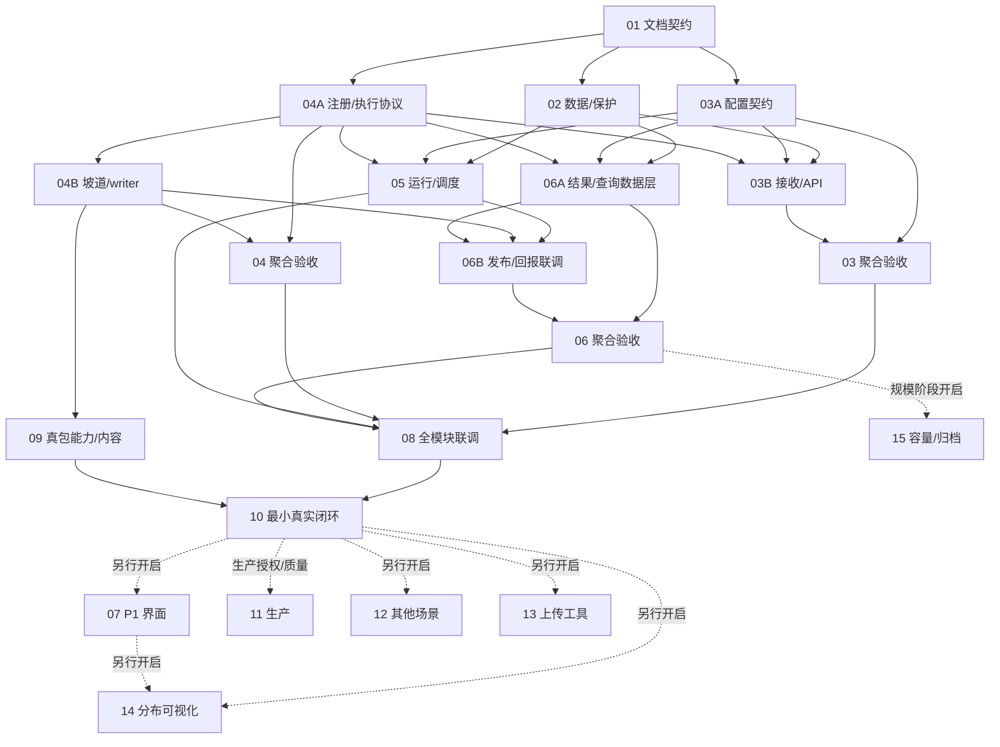

# Bag 场景处理服务任务单

版本：v0.3.2，2026-10-08。P0 本地执行已开启（用户授权），协调者（飞书「后端功能开发」）负责验收/派发/共享文档。TASK-01～15 编号保留，03/04/06 按已有产物拆为 A/B 子任务；父任务仅聚合验收，不再派一个执行者重复实现。旧版本 DONE 只代表相应文档或已记录证据，不能移用为本版实现完成。

## 1. 唯一任务状态与依赖表

TODO 是专项任务状态唯一入口。协调者更新状态/owner；执行者只能维护自己的回执，不能并发改本表。当前只有文档授权，READY 表示技术上可接，不代表业务开发已经获得执行授权。

**状态标志**：✅=DONE（已合入 main + 协调者验收闭环）｜🔁=REWORK（OCR 返修中，owner 执行）｜🔧=RUNNING（owner 开发中）｜⏸️=READY 待派（依赖齐备，等空槽）｜⏳=WAITING（被依赖阻塞）｜🚫=BLOCKED（缺外部授权）｜🕓=DEFERRED（阶段未开启）｜📄=文档项

| 任务 | 标志 | 交付行为 | REQ / AC | 依赖 | 阶段与状态 | owner / attempt |
|---|---|---|---|---|---|---|
| TASK-01 | 📄✅ | 最小范围、接口、完整并行/接续及共享文档契约 | REQ-01～13 / AC-01～13 | 无 | DONE（仅 v0.3.2 文档） | 协调者 / 文档 |
| TASK-02 | ✅ | 必要数据模型/迁移、血缘标签、索引与清理防线、旧 ID 风险盘点 | REQ-02、04、08、13 / AC-02、04、08、13 | TASK-01 | DONE（527b033+e10cab4+a317e48 合入 main a317e48；协调者独立复验 MySQL 8.4 隔离库 upgrade/downgrade/派生回滚拒绝/重入 + server_default/CASCADE DDL 硬证据全过） | 1号会话 / attempt-1 |
| TASK-03 | ⏳ | 完整接收服务聚合验收 | REQ-01、08、10、13 / AC-01、08、10、13 | TASK-03A、TASK-03B | WAITING（聚合不派发；03A✅ + 03B🔁 返修中） | 协调者 |
| TASK-03A | ✅ | 配置 DTO、纯解析、能力读取协议及限额 | REQ-01、10、13 / AC-01、10、13 | TASK-01 | DONE（67f9f4c 合入 8e97ef1，OCR 三轮收敛，接口 scene-config-v1） | 3号会话 / attempt-2 |
| TASK-03B | 🔁 | 持久配置/API、Scanner 绑定、统一登记与用途事件 | REQ-01、08、10、13 / AC-01、08、10、13 | TASK-02、TASK-03A、TASK-04A | REWORK 收口中（14b7a64 attempt-2：2 medium 已修+协调者核实、2 high 判误报+两代同路径回归固化、3 critical 接受隔离库裁决；全量 664 协调者独立复跑确认；等 OCR 复审收口后合入） | 3号会话 / attempt-2 |
| TASK-04 | ✅ | 完整坡道适配聚合验收 | REQ-03、09、10 / AC-03、09、10 | TASK-04A、TASK-04B | DONE（聚合验证 PASS：协调者脚本在 main eaf632a 端到端确认 slope-v1 enabled+适配器注册+config_hash 一致+跨字段约束拒绝+真实 Image 封装 fixture analyze→SUCCESS/6 段可发布） | 协调者 |
| TASK-04A | ✅ | 注册/区间/执行协议、测试能力及正式坡道描述 | REQ-03、10 / AC-03、10 | TASK-01 | DONE（a23c541 合入 94cfc2f，OCR 三轮收敛，接口 scene-capability/v1） | 2号会话 / attempt-2 |
| TASK-04B | ✅ | 坡道结构化适配、时间映射、writer 和证据引用 | REQ-03、09、13 / AC-03、09、13 | TASK-04A | DONE（合入 eaf632a：真实坡道适配器+CDR+时间映射+writer、真实 A100 样本 golden 锚定、CDR pos 偏移 attempt-2 修复+回归、OCR 0 findings、672 passed；slope enabled=true 已生效） | 2号会话 / attempt-2 |
| TASK-05 | 🔧 | 用途事件消费、场景运行 API、队列/执行面/租约 | REQ-01、03、06、08、10 / AC-01、03、06、08、10 | TASK-02、TASK-03A、TASK-04A | RUNNING（2026-10-09 00:5x 派 1号；02 已验收闭环） | 1号会话 / attempt-1 |
| TASK-06 | ⏳ | 完整结果使用/发布恢复聚合验收 | REQ-02、04、05、06、07、13 / AC-02、04、05、06、07、13 | TASK-06A、TASK-06B | WAITING（聚合不派发） | 协调者 |
| TASK-06A | 🔧 | 区间/结果仓储、验证协议、Bag 检索/血缘数据层 | REQ-02、04、05、06、13 / AC-02、04、05、06、13 | TASK-02、TASK-03A、TASK-04A | RUNNING（2026-10-09 06A 派 2号；依赖 02/03A/04A 全 DONE；与 03B 返修零文件重叠可并行） | 2号会话 / attempt-1 |
| TASK-06B | ⏳ | 正式回报 API、原子发布、幂等登记、换版/对账 | REQ-02、05、06、07、08 / AC-02、05、06、07、08 | TASK-05、TASK-04B、TASK-06A | WAITING（交接约束：writer storage_offset_ns 由编排层从 manifest 推导，不可推导则阻塞发布） | 未领取 |
| TASK-07 | 🕓 | 统一界面、人工纠错/下架、预览 | REQ-04、05 / AC-04、05 | TASK-10 | P1 DEFERRED（阶段未开启） | 未领取 |
| TASK-08 | ⏳ | 接收/调度/结果联调、故障并发、兼容及小规模查询检查 | REQ-01～08、10、13 / AC-01～08、10、13 | TASK-03、TASK-04、TASK-05、TASK-06 | WAITING（等 03/04/05/06 聚合） | 未领取 |
| TASK-09 | 🚫 | 坡道真包、视觉能力、时间与小样本内容核验 | REQ-03、09 / AC-03、09 | TASK-04B | BLOCKED（04B🔁 + 需用户授权真实坡道样本/VLM 服务） | 未领取 |
| TASK-10 | ⏳ | 目录→坡道切片→数据库→API 获取真实工程闭环 | REQ-01～10、13 的 P0 部分 / 对应 AC 的 P0 部分 | TASK-08、TASK-09 | WAITING | 未领取 |
| TASK-11 | 🚫 | 单包生产启用、备份、质量及部署门禁 | P0 对应 REQ / AC | TASK-10 | PRODUCTION BLOCKED（独立授权/质量门禁） | 未领取 |
| TASK-12 | 🕓 | 其他四类场景逐类接入与质量验收 | REQ-03、09、10 / AC-03、09、10 | TASK-10 | P1 DEFERRED | 未领取 |
| TASK-13 | 🕓 | 插盘上传工具接入服务 | REQ-01、11 / AC-01、11 | TASK-10 | P2 DEFERRED | 未领取 |
| TASK-14 | 🕓 | 分布统计接口和可视化 | REQ-12 / AC-12 | TASK-10、TASK-07 | P3 DEFERRED | 未领取 |
| TASK-15 | 🕓 | 完整容量基线、必要旧表改造、冷热归档/恢复 | REQ-13 / AC-13 | TASK-06 | SCALE DEFERRED | 未领取 |

### 各功能模块开发进度（2026-10-09 00:5x）

```
数据层 02        ████████████████████ ✅ DONE（含 OCR 两轮修复 + 协调者隔离库复验）
配置 03A         ████████████████████ ✅ DONE（scene-config-v1）
能力协议 04A     ████████████████████ ✅ DONE（scene-capability/v1）
坡道适配 04      ████████████████████ ✅ DONE（04B 合入 eaf632a + 聚合验证 PASS：端到端 analyze→SUCCESS/6 段）
接收 03B         █████████████████░░░ 🔁 ~90%（14b7a64 返修完成，OCR 复审中，随后合入）
调度 05          ████░░░░░░░░░░░░░░░░ 🔧 开发中（1号；注意：在主工作区开发，验收前须先 commit）
结果仓储 06A     ██░░░░░░░░░░░░░░░░░░ 🔧 已派 2号（04B 腾出空槽；与 03B 零重叠可并行）
联调/闭环 08/10  ░░░░░░░░░░░░░░░░░░░░ ⏳ 被上游阻塞
```

**主线进度**：P0 15 个任务中 ✅5（含文档📄1、聚合04）｜🔁1｜🔧2｜⏳4｜🚫2｜🕓3。集成基线 main=eaf632a 已推 GitLab origin。下一收敛点：03B OCR 复审 → 合入 → 03 聚合标 DONE；05(1号)/06A(2号) 并行推进 → 06B → 08/09/10 联调闭环。

首波三个执行者：TASK-02、TASK-04A、TASK-03A。接续见 §6；最多三执行者不是全程必须占满三人，聚合、验收与共享文档由协调者处理。

## 2. 范围、执行与完成定义

- 当前只修改四份文档，不启动代码、模型、迁移或生产操作。后续开启 P0 本地执行时，授权覆盖哪些动作由协调者在 HANDOFF 明确，避免每个已授权任务反复询问。
- 需求/契约版本为 v0.3.2；本轮只读 catalog HEAD=054b753，领取时重新核对基线和迁移，保护其他工作区改动。
- 所有改动必须服务现有 P0 AC 或本链路必要数据保护。空闲不能作为开启 TASK-07/12/13/14/15 的理由；TASK-11 独立生产授权，P0 在 TASK-10 后停止。
- 复用 Backend 唯一写库边界、Scanner、现有租约与坡道算法，不顺带升级依赖、重构旧自建/NVIDIA、搭建调度平台或实现全套插件/归档系统。
- 每个子任务只完成其验收范围。构造事件、测试能力和 Repository 替身可以证明模块契约，不能证明完整接收/发布或真实识别。最终由 TASK-08/09/10 收敛。
- 执行者交付状态为 REVIEW_PENDING；协调者独立检查、验证合入集成基线、更新共享文档后才能标 DONE。下游只消费已接受 commit/接口版本。
- 千问工具执行能力未实测。只有文本接口时返回补丁与建议，由授权执行器验证；有真实工具才可报告命令/退出码。共享写入规则见 HANDOFF §5。
- 默认同一原因最多两轮返修后提交升级包，不无限试错。协调者可依据证据安排最小修复或标 BLOCKED；不得删测试、改成功标准或擅自增加目标。

## 3. P0 执行卡

状态和依赖以 §1 为准。每项回执统一包含 owner/attempt、工作树/base、需求/接口版本、实际输出 commit/diff、命令/退出码、AC、未执行项及待修订文档。各任务默认不含生产操作。

### TASK-02：必要数据与保护防线

- 阅读：PRD §4/7；DESIGN §4/8.1/9；app/models.py、source_service、bag_cleanup_service/source_fence、alembic/versions/。
- 修改：模型、必要迁移、血缘/标签基础、清理守卫及隔离库验证；独占迁移链，不改算法/路由。
- 输出：新表 BIGINT、角色/用途、分析/区间、血缘、标签来源、唯一性/索引及证据定位；旧 ID/FK 类型/空间和锁影响报告。
- 验收：父子不归并/不级联、原 ID/UID 保留、旧清理各阶段阻断、历史用途/活动任务兼容；在隔离 MySQL 验证必要迁移。
- 边界：低成本 ID 扩容可同批，高成本重建列 TASK-15 并标未完成，不把“整库容量改造”当 P0 阻塞。无法保护现有数据则 BLOCKED，不以最小链路跳过。
- 下游：数据/约束提交合入后，03B/05/06A 可使用正式仓储模型。

### TASK-03：完整接收聚合验收

- 不单独派发；03A/03B 接受后由协调者核对完整 API、配置覆盖、绑定及三用途事件证据。
- 两个子任务只有局部通过时，父任务仍 WAITING；服务身份/路径和冻结规则不得缺失。

### TASK-03A：配置 DTO 与纯解析

- 阅读：DESIGN §2/3/7/8.1/11；当前 Pydantic/OpenAPI 模式。
- 修改：配置 DTO、纯解析、能力读取协议及测试；不碰 ORM/迁移/Scanner/全局入口。
- 输出：入口+选择+能力描述→EffectiveConfig/hash，允许参数、版本固定及请求/JSON 限额。
- 验收：集合替换默认、无效/空场景、非法参数、幂等输入/限额可确定性验证；使用读取协议替身，不硬编码全场景可用。
- 交接：配置契约与 04A 的描述/区间契约一致，经协调者接受后供 03B/05/06A 使用。

### TASK-03B：配置持久化与接收集成

- 阅读：父 TASK-03、02/03A/04A 输出；DESIGN §3/7；source_service、catalog_ingest、Scanner、登记路由。
- 修改：真实能力/入口查询、提交 API/存储、原路径绑定、Scanner 身份透传和持久用途事件。
- 验收：配置/绑定竞争、幂等/路径抢占、incoming→ready/重启保持快照，三用途事件与旧入口兼容。
- 边界：不等待坡道推理实现，不执行推理；以约定事件交 TASK-05 消费，不能生产使用 Repository 替身。

### TASK-04：完整坡道适配聚合验收

- 不单独派发；04A/04B 接受后确认注册描述、输入/输出、真实适配、writer 和证据一致。
- 04A 的测试能力不代替真实坡道实现，真样本的模型/时间证明由 TASK-09 完成。

### TASK-04A：注册及统一执行契约

- 阅读：DESIGN §2/4/5/11；ros2_slice analysis_perform、request_slope、analysis_slope、writer 的输入输出。
- 修改：版本化能力注册、能力/区间/manifest 与 RunContextValidator/Repository 协议、测试能力和契约测试。
- 输出：坡道参数/输出/发布标签描述、统一分派、时间单位/证据格式；真实实现未接入前不在现网宣称可用。
- 验收：新增测试适配器无需核心分支；错误/无命中/不适用有不同语义，与 03A DTO 一致。
- 交接：04B 立即可接；02/03A 已接受时，03B/05/06A 同时具备接口依赖。

### TASK-04B：坡道与 writer 适配

- 阅读：04A 契约、DESIGN §2/4/5/6；ros2_slice 坡道请求/分段、抽帧、slice_perform。
- 修改：结构化坡道适配、时间映射、writer、取消协作、缓存和证据引用，原项目作对照。
- 验收：抽帧失败不当 [] 无命中，slope/flat 分开，整数时间、多 DB3/乱序边界和非空写包；用确定性 fixture，不依赖 CSV/人工补字段。
- 边界：不改自建正式脚本，不接其他场景，不直连数据库；无法可靠映射真实时间时说明并阻塞真包验收。
- 交接：可打开 TASK-09；与 05/06A 完成一起解锁 06B。

### TASK-05：运行与调度消费者

- 阅读：02/03A/04A 输出；DESIGN §3/5/6/7；pipeline_service、domain、Orchestrator、代理和资源服务。
- 修改：运行 API、用途事件消费、类型/队列/枚举、执行面、步骤/结果与租约；枚举归本任务唯一 owner。
- 验收：同父不同用途不复用错 run，重复事件幂等，租约/取消/启动不确定先对账，原 Phase0 默认链不误接。
- 边界：按固定事件协议用 fixture 验证消费者，不等待 Scanner；真实生产者+消费者在 TASK-08 联调。03B 的接收文件不由本任务同时修改。
- 交接：提供正式 RunContext/租约验证给 06B，模块 DONE 不代表完整流水线已跑通。

### TASK-06：结果与发布聚合验收

- 不单独派发；06A/06B 接受后核对结果可用性、血缘、当前版本与发布恢复证据。
- 06A 的数据查询或替身成功不代表 NAS 文件已经验证、登记或可用。

### TASK-06A：结果仓储与使用数据层

- 阅读：02/03A/04A 输出；DESIGN §4/6/7/8.1；artifact_service、Bag 查询/manifest 及源 fence。
- 修改：区间/派生/标签仓储、批次幂等、有界检索/血缘、验证协议和数据库测试；不接真实执行回报入口。
- 验收：稳定身份/唯一性、当前与历史、父子同指纹隔离、分页/JSON 上限、必要索引/实际 SQL；区间证据可查。
- 边界：验证上下文可使用契约替身做单测，正式租约/源校验必须由 06B 对接 05；仅数据层验收，不宣称发布成功。
- 交接：06B 复用正式仓储/查询，不另建切片索引。

### TASK-06B：回报、发布及对账联调

- 阅读：05/04B/06A 的接受输出；DESIGN §6/7/9，执行/结果路由、NAS 发布与源 fence。
- 修改：真实回报/complete-scene API、staging 校验/原子发布、子 Bag 登记、换版/对账及重试。
- 验收：真实租约/源代次验证、重复单子包、发布后登记故障补偿、晚到旧版不倒退、新版失败保旧/无命中切空、PENDING 不展示可用。
- 边界：文件非空/可打开/时间证据和数据库登记均完成才可用；输出不入 Scanner，预览非阻断，不复制父/子文件。
- 交接：关闭父 06 后，03/04/05 完成即可接 TASK-08。

### TASK-08：模块联调、故障与兼容

- 阅读：全部 P0 AC 与 03/04/05/06 真实输出。
- 输出：接收事件→调度→结果回报联调、重启/并发/发布断点、清理竞争和旧流程回归；小规模 SQL、索引、分页/查询次数、耗时/空间检查。
- 验收：三用途、配置冻结、子包不递归、旧自建/NVIDIA 不回归；完整模块不保留测试旁路，原文件不变。
- 边界：不等待页面/其他场景，不卡十万/百万压测；mock 只证明契约，真包工程证据由 09/10 提供。
- 失败：报告影响任务，协调者回派最小修复；不能自行跨所有模块改代码。

### TASK-09：坡道真实能力与内容核验

- 阅读：04B 输出、DESIGN §2/4/5/10；需授权坡道样本和视觉服务。
- 输出：真实模型能力、header→bag 时间证据、少量阳性/阴性及边界核验、样本/模型/规则摘要和限制。
- 验收：至少有实际坡道切片样例可核对，错误不伪装为无命中；能力、内容和时间分别有证据。
- 边界：不为 P0 扩成完整标注工程；可用标注就报告实测，阈值不足不宣称生产就绪。生产质量门禁仍在 TASK-11。
- 阻塞：缺模型/样本或时间不可靠时标 BLOCKED 并释放工作槽，只阻塞相应真包链路。

### TASK-10：最小工程闭环

- 阅读：08/09 接受证据、P0 AC 与本地隔离环境规则。
- 输出：指定目录上传/配置→真实坡道→切包→NAS+数据库→API 获取的实际回执，必要迁移/恢复守卫及风险。
- 验收：切片非空可打开、区间内容合理、父子/标签/当前版可查、获取有效、原包不变，P0 必要基础完整。
- 边界：不等 UI/其他四类/工具/可视化/规模压测，工程通过不等于生产精度/容量/部署通过。
- 结束：由协调者更新最终 HANDOFF/TODO，停止 P0 派发，不自动转 TASK-11 或后续阶段。

### TASK-11：生产门禁与启用（不在自动 P0 范围）

- 前提：TASK-10、业务质量阈值及适用标注验收、用户当次明确生产授权、备份/迁移/路径和项目发布门禁；批量扩张另需 TASK-15。
- 输出：受控迁移/部署、单包真结果及部署后本地收敛证据，按项目规则维护真实部署记录。
- 禁止：因 TODO 依赖满足自动发布、全量补跑历史、改原包或跳过质量/备份。

## 4. 后续任务（默认 DEFERRED）

### TASK-07：统一界面及人工修订

- 依赖：TASK-10，阶段需明确开启。
- 阅读：PRD §6.1、DESIGN §7.2，web/bags 和现有标签/获取组件。
- 输出/验收：三视图、动态进度、父子详情、审计修订/下架与预览；旧链接兼容、写身份/row_version/原因可查。
- 边界：不阻塞 P0，不能因为空闲自动开做。

### TASK-12：其他场景逐类接入

- 依赖：TASK-10，P1 开启后按场景材料拆分，不提前无限拆任务。
- 阅读：对应算法分支与注册协议；每类独立记录输入/参考图/模型及标注条件。
- 输出/验收：按需新增适配版本、多场景部分失败/共享预处理、逐类真实质量；水雾缺材料只阻塞水雾。
- 边界：不新增核心场景硬编码分支，不擅自替换参考图。

### TASK-13：插盘上传客户端

- 依赖：TASK-10，P2 开启并明确设备/GUI/传输方式后才能 READY。
- 输出/验收：查询能力、选择用途/场景、先提交后传输、状态/失败/重传一致，不直连数据库或自行识别。
- 边界：不自动开启工具开发，不改变原包不可变约束。

### TASK-14：分布可视化

- 依赖：TASK-10/TASK-07，P3 开启后细化图表。
- 输出/验收：当前有效结果、DISTINCT 包数、累计/并集时长、换版/纠错/下架补偿与刷新时间。
- 边界：不扫逐帧日志，不将重叠分组直接相加冒充覆盖率。

### TASK-15：规模容量及必要后置改造

- 依赖：TASK-06，规模阶段开启；接收 TASK-02 明确后置的 ID/旧表风险。
- 输出/验收：按实际容量预算执行十万/百万级基线、增长预测、必要全文/索引/旧表改造及归档/恢复验证。
- 边界：已有 DatasetFrame 基线不能替代场景证据，核心 FK/血缘保持完整，不自动删除原始/切片；不因依赖已完成进入 P0。

## 5. 验证与回执

后续代码任务在 /home/wang/work/rosbag-catalog 按适用范围验证：

```bash
./scripts/local_quality_gate.sh
.venv/bin/alembic heads
./scripts/local_stack.sh test
git diff --check
```

新增定向测试/命令在实现后记录，不提供不存在的文件；MySQL 迁移/恢复/造数仅隔离库，共享资源由协调者安排。项目审查/提交规则保持，不将分支、容器或 HTTP 成功当任务验收。

本轮文档检查版本、链接、REQ/AC/任务、子任务无环、接续表与图一致、三 READY、DEFERRED 不自动启动、共享单写和范围边界。文档在 catalog Git 外，不混入该仓库提交。

## 6. 完整依赖、并行与接续

### 6.1 依赖图



实线是技术依赖，虚线还受阶段/生产授权门禁；依赖表是事实来源，图改变时必须同步。

### 6.2 完成事件与候选任务

“候选”不是立刻派发：必须所有依赖 DONE、输入/权限具备、阶段已开启且文件/资源锁可用。父 03/04/06 由协调者聚合，不占执行槽。

| 已接受的完成事件 | 立即重算的候选 |
|---|---|
| TASK-01 | TASK-02、TASK-03A、TASK-04A |
| TASK-02 | TASK-03B、TASK-05、TASK-06A |
| TASK-03A | TASK-03B、TASK-05、TASK-06A、父 TASK-03 |
| TASK-04A | TASK-04B、TASK-03B、TASK-05、TASK-06A、父 TASK-04 |
| TASK-03B | 父 TASK-03 |
| 父 TASK-03 | TASK-08 |
| TASK-04B | TASK-06B、TASK-09、父 TASK-04 |
| 父 TASK-04 | TASK-08 |
| TASK-05 | TASK-06B、TASK-08 |
| TASK-06A | TASK-06B、父 TASK-06 |
| TASK-06B | 父 TASK-06 |
| 父 TASK-06 | TASK-08；TASK-15 仍 DEFERRED |
| TASK-08 或 TASK-09 | TASK-10 |
| TASK-10 | P0 停止；TASK-07、TASK-12、TASK-13、TASK-14 仍 DEFERRED，TASK-11 仍有生产门禁 |
| TASK-07 | TASK-14，阶段不开仍 DEFERRED |
| TASK-11/12/13/14/15 | 更新该阶段结果，无默认新增任务 |

### 6.3 三槽动态分配

初始 A=02、B=04A、C=03A，仅是首波推荐，不永久绑定 owner。04A 先完成可立刻续 04B；02/03A/04A 均接受后，03B/05/06A 三项可并行，视剩余槽和 04B 在途情况派发。

已满足依赖的 P0 叶任务默认优先序：06B → 05 → 06A → 03B → 04B → 09 → 08 → 10 → 04A → 03A → 02。先过滤授权/输入/路径锁再排序；同一任务只派一次，优先保留相关模块经验，但不能因原 owner 忙而让其他空闲执行者无限等待。

有能力消息工具时，协调者在接受完成后立即向空闲执行者派下一任务并携回执/基线；没有自动唤醒工具时由协调者持续处理回执与派单，文档本身不会自动运行。没有 READY 可等待依赖或报告阻塞，不提前开启后续阶段或制造新任务来填槽。

## 7. 领取、验收、接续与中断

### 7.1 状态与唯一 owner

状态：WAITING（依赖）→READY→RUNNING→REVIEW_PENDING→DONE；BLOCKED 表示明确输入/契约/执行阻塞，DEFERRED 表示阶段未开启。聚合父只 WAITING/DONE，不重复派发。

协调者领取前检查当前授权阶段、全部依赖的接受 commit/接口版本、未失效证据、owner/工作树及共享文件锁；在同一次派发记录 TASK、attempt、owner、base 和回执路径。状态表只有协调者写，执行者不能同时自领取。最多三个 RUNNING，资源密集测试另按租约/串行约束。

### 7.2 每次完成必须做的调度循环

1. 执行者写本专项共享目录下自己的 `receipts/<TASK-ID>/attempt-<n>.md`，通知协调者“待验收”，附实际 diff/commit、测试及文档修订建议，不自标 DONE；只有文本接口时返回模板内容，由协调者代存。
2. 协调者独立验收，确认范围/必要测试/证据；合入指定共享基线并检查相关消费者兼容。尚未合入或证据缺失保持 REVIEW_PENDING。
3. 协调者更新 TODO 状态与 owner、HANDOFF 当前基线/接受回执/阻塞/下一批；有契约变化先更新 DESIGN，业务范围变化才更新 PRD 并取得相应决定。
4. 子任务完成后尝试聚合父验收，按 §6.2 计算所有候选，排除阶段未开启、缺材料、在途 owner 或文件锁冲突。
5. 有空槽按 §6.3 派发，传 TASK 卡、需求/接口版本、集成 base、最小阅读集、依赖回执、允许范围和验收。执行者完成后重复此循环，不需再次让用户手动指派每个已授权 P0 任务。
6. TASK-10 接受后汇总实际产物/限制，停止 P0；不自动继续生产或后续阶段。

### 7.3 阻塞、失效与接管

- 执行者遇到冲突、同因返修超限或缺外部输入，写回执并通知；协调者标 BLOCKED、写解除条件、释放该开发槽，将其他 READY 派给空闲者。不能自动把 FAILED/未验收输出当依赖。
- 验证失败只回派本任务必要修复；跨模块改动需协调者指定 owner，更新涉及的契约和要重跑的 AC。若接受产物已失效，对应 DONE 撤回并同步下游暂停/重验。
- 接管旧 RUNNING 前，核实工作树、未提交改动、进程/远端任务/资源租约与 owner 状态；超时不代表停止。确认旧执行者/进程不再写后才新建 attempt，不 reset 或覆盖已有工作。
- 中断/会话结束时，协调者更新 HANDOFF 的实际 scope、base、RUNNING/REVIEW_PENDING/READY/BLOCKED、owner/回执和下个动作；新会话先恢复该检查点，不重新重复领取已完成任务。

共享更新责任和回执模板见 [HANDOFF](HANDOFF.md)；产品边界见 [PRD](PRD.md)，协议见 [DESIGN](DESIGN.md)。
